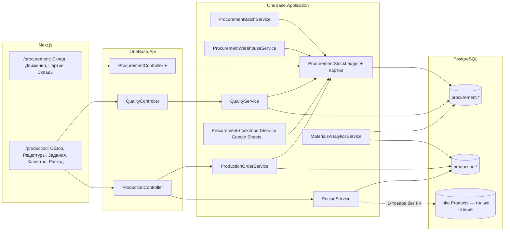
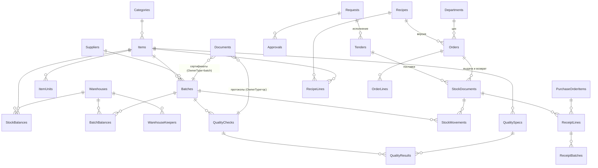
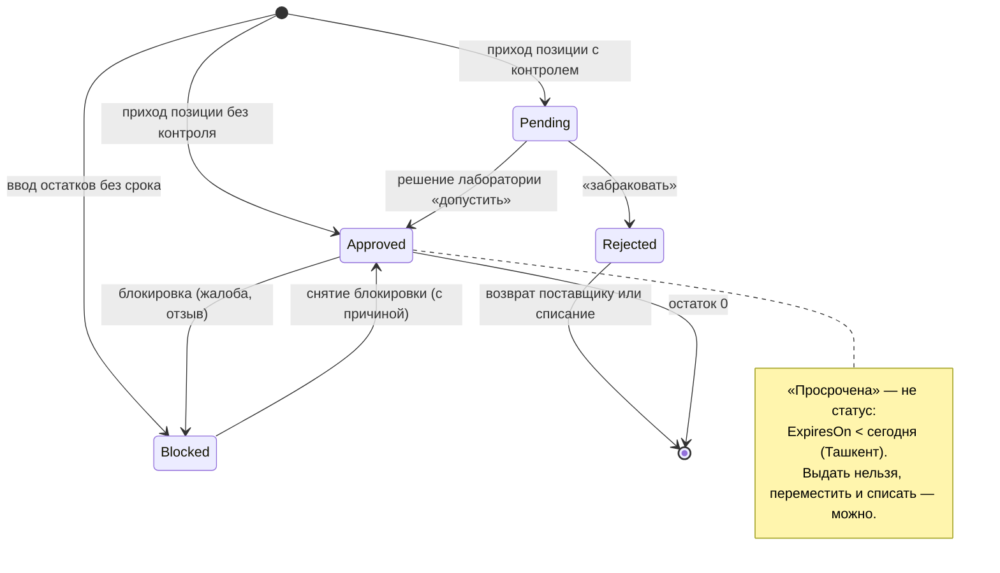
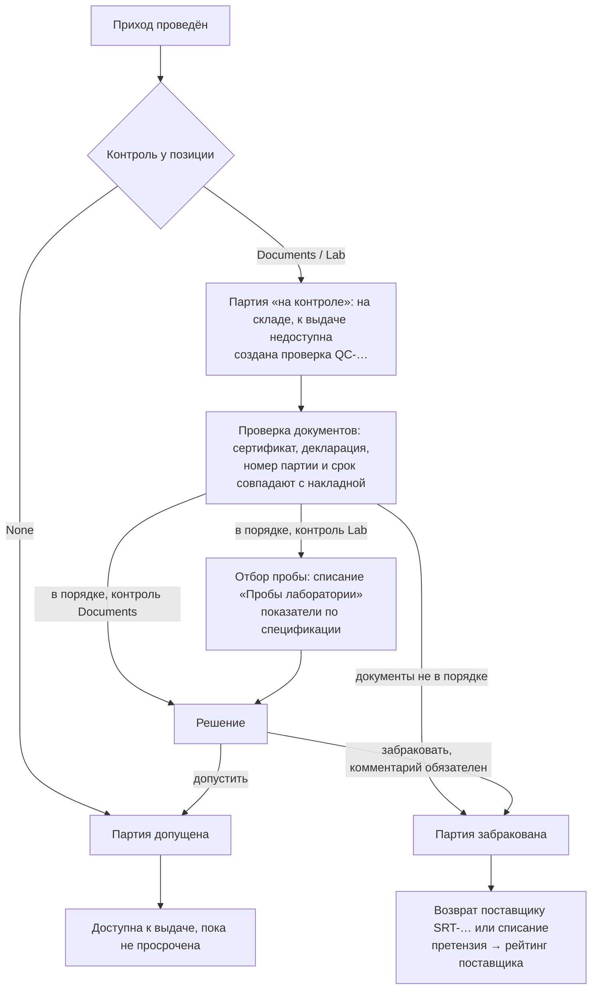
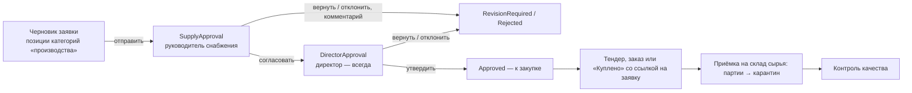
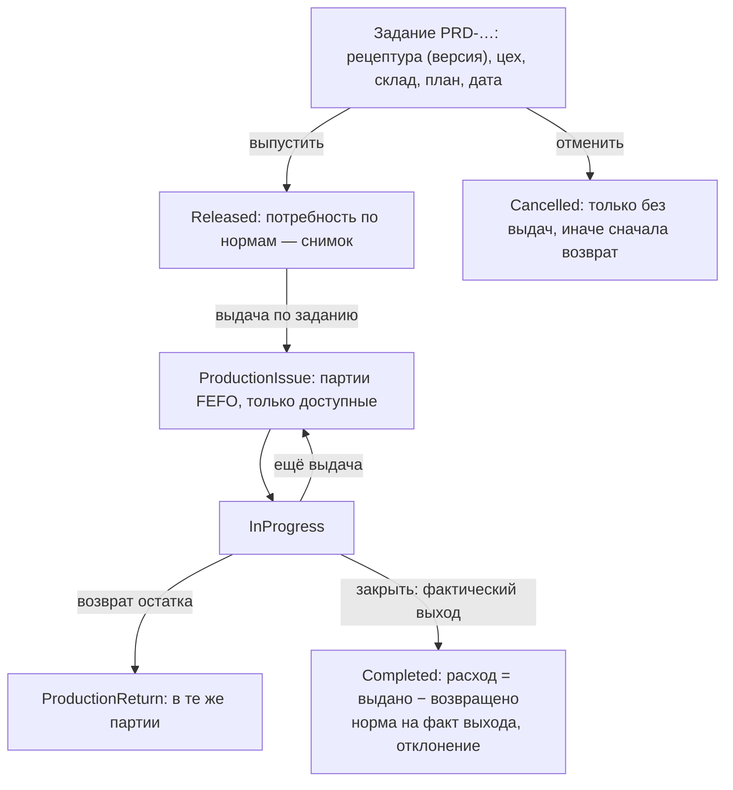

# Сырьё (Raw Material Management): аудит OneBase и план внедрения — этап 0

Дата: 05.11.2026. Ветка `main` (`9f2d443`).

Документ — для проверки перед реализацией. Кода, схемы БД, `.env`, данных и production аудит не менял, платных AI-запросов не было.

## Как проводился аудит

- Прочитан исходный код:
  - backend: `OneBase.Api`, `OneBase.Application`, `OneBase.Domain`, `OneBase.Infrastructure`, `OneBase.AI`;
  - frontend: оболочка, модуль «Снабжение», импорт файлов, i18n;
  - настройки EF (`*Model.cs`), сидер, тесты.
- Изучены документы: прежние аудиты снабжения (`ONEBASE_PROCUREMENT_*.md`) и `docs/`.
- Каждый факт ниже подтверждён ссылкой `файл:строка`. Где сказано «нет», искали по коду (русские и английские слова: партия, срок годности, рецептура, лаборатория, batch, lot, expiry, recipe, BOM, quality).
- **Отчёт `ONEBASE_PROCUREMENT_FINAL_AUDIT.md` устарел.** В нём «утверждает только директор». В коде — маршрут «руководитель отдела → финансист → директор (выше лимита)» и новый путь закупки «Куплено». Ниже — по коду.

---

## 0. Коротко

| # | Факт | Следствие для модуля «Сырьё» |
|---|---|---|
| 1 | **Склад снабжения уже есть** — каталог, остатки, документы, неизменяемый журнал движений, резервы, инвентаризация, импорт журнала из Excel (`Domain/Procurement/ProcurementStock.cs`, `Application/Procurement/ProcurementStockLedger.cs`). | Второй склад не строим. «Сырьё» — расширение склада снабжения: склады, партии, качество. |
| 2 | **Сырьё уже идёт через этот склад.** Импорт заводит незнакомые позиции в категорию «Сырьё», цеха — отделами, понимает «Испарения» и «Утилизацию» (`ProcurementStockImportService.cs:48-58`). | Каталог материалов = `procurement.Items` с профилем сырья. Новая сущность «материал» не нужна. |
| 3 | **Склад один.** «Пока один — «Центральный склад»; несколько складов — позже» (`ProcurementStock.cs:34`). Но `WarehouseId` уже есть у остатков, документов, движений, резервов и импорта. | Мультисклад — без смены ключей: справочник складов, выбор склада в операциях, перемещения. |
| 4 | **Партий и сроков годности нет.** Остаток — по паре «склад × позиция» (`ProcurementModel.cs:167`). Столбец «Партия» из Excel пишется текстом в номер документа (`ProcurementStockImportService.cs:419-422`). | Новые таблицы: партия и остаток партии. Остаток позиции остаётся итогом по её партиям. |
| 5 | **Контроля качества нет.** Подтверждённая приёмка сразу даёт свободный остаток. Брак просто не приходуется (`ProcurementStock.cs:153-183`). | Новое: карантин, проверка документов, лаборатория, решение по партии. |
| 6 | **Тендерное сырьё на склад не приходуется:** «сырьё идёт в производство» (`ProcurementTender.cs:14-17`). | Прямое противоречие ТЗ: поставки по тендеру должны приниматься на склад партиями с контролем качества. |
| 7 | **Согласование заявок:** руководитель отдела → финансист → директор, только если сумма больше лимита (по умолчанию 5 млн сум) (`ProcurementRules.cs:126-144`, `ProcurementStock.cs:302`). Роли «Procurement Manager» нет. | Маршрут сырья «руководитель снабжения → директор» — новый вариант существующего маршрута. |
| 8 | **Общего движка согласований нет.** `ApprovalsController` и `ApprovalRequest` — только подтверждение действий AI-агентов. Согласование снабжения зашито в статусы. | «Существующий Workflow» = маршрут снабжения (статусы + `procurement.Approvals`). Его и расширяем. |
| 9 | **Мультитенантности нет:** одна база, одна компания (`docs/data-sources.md:292`, ни одного `TenantId` и фильтра запросов в `OneBaseDbContext`). | «Tenant isolation» из ТЗ = изоляция по правам, отделам и складам. |
| 10 | **Производства в OneBase нет.** Роль «Производство» даёт только `sales.read` (`SystemRoles.cs:67`). Готовая продукция — в Linko, только чтение (`Domain/Sales/Linko.cs:35-47`). Поступлений от цехов OneBase не синхронизирует. | Рецептуры и задания на выпуск — новые. Выход — ссылка на товар Linko без внешнего ключа. Готовую продукцию на склад OneBase не приходуем. |
| 11 | **Журнал аудита — два:** общий `AuditLog` и история документа `procurement.AuditLog` (было/стало, в той же записи, что и изменение). `AuditLogger.LogAsync` сам вызывает `SaveChanges` (`Infrastructure/Audit/AuditLogger.cs:19-28`). | Операции склада пишут историю в `procurement.AuditLog` той же записью. Общий журнал — только после фиксации. |
| 12 | **История закупочных цен считается только по строкам заказов поставщикам** (`ProcurementInsightService.cs:107-137`). Тендеры и цены из импорта в неё не входят. | Отдельную таблицу цен не заводим: источники — заказы, тендеры, цены партий. |

---

## 1. Противоречия между текущей архитектурой и ТЗ

| # | ТЗ | Как сейчас (код) | Что предлагаю | Решение |
|---|---|---|---|---|
| П1 | «Сохранить Tenant isolation» | Изоляции по организациям нет и не было: одна компания (`docs/data-sources.md:292`; в `OneBaseDbContext.cs` нет `HasQueryFilter`). | Мультитенантность не вводить. Изоляция — права модуля, отделы (`work.DepartmentHeads`) и склады. Несколько компаний — отдельный проект всего OneBase. | D1 |
| П2 | «Использовать существующий Workflow» | Общего движка нет. Маршрут заявки — статусы `ProcurementRequestStatus` и функции `FirstStep`/`NextStep` (`ProcurementRules.cs:126-144`). Решения — в `procurement.Approvals` (раунд, шаг, решение, снимок; `ProcurementStock.cs:273-292`). | Расширить маршрут снабжения: новый шаг `supply` и вариант маршрута для сырья. Общий движок не строить. | D2, D3 |
| П3 | Закупка: Procurement Manager → Director, последовательно | Руководитель отдела → финансист → директор, директор — только выше лимита. Снабжение (`procurement.manage`) заявки не согласует (`ProcurementRules.cs:167-168`). | Для сырья: руководитель снабжения → директор, всегда, без лимита. Финансиста — по решению D4. | D2–D4 |
| П4 | Тендерные закупки сырья — со склада и контролем качества | Тендер — журнал, на склад не приходуется (`ProcurementTender.cs:14-17`). | Поставка по тендеру = приёмка на склад сырья: партии, карантин, лаборатория. Тендер — исполнение утверждённой заявки. | D3 |
| П5 | Несколько складов | Один «Центральный склад» засевается при запуске (`DbSeeder.cs:195-198`). Код берёт склад по умолчанию (`ProcurementStockLedger.cs:41-45`). Перемещений нет: виды движения — приход, выдача, списание, корректировка (`ProcurementStock.cs:62-75`). | Справочник складов, склад в каждой операции, документ «Перемещение». Заявки резервируют, как сейчас, со склада по умолчанию. | D7 |
| П6 | У каждой партии — срок годности; при перемещении партия сохраняется | Партии нет: остаток и движение — по позиции (`ProcurementModel.cs:167`, `ProcurementStock.cs:201-225`). Партия из Excel — текст в `Reference`. | Таблицы `Batches` и `BatchBalances`, `BatchId` у движения. Перемещение двигает ту же партию. | — |
| П7 | Имеющиеся остатки → партии со сроком | Текущие остатки сроков не знают. Импорт при минусе заводит позицию нулём (`Clamped`). | Сроки не выдумывать: «ввод партий» по факту. До ввода позиция в производство не выдаётся. | D6 |
| П8 | Неподтверждённое качество нельзя выдавать | Приёмка по заказу и «Куплено» сразу дают свободный остаток и резерв под заявку (`ProcurementStockLedger.cs:122-163`). | Приход сырья — в карантин (партия «на контроле»). Свободно — только допущенные и не просроченные партии. | D12 |
| П9 | Просроченное автоматически недоступно | Понятия срока нет. | Доступность считается по дате (Ташкент, `FieldClock.LocalDate`) при каждом чтении и проводке. Фоновая задача только напоминает. | D11 |
| П10 | Резерв со склада по заявке | Резерв — на уровне позиции, без партий и качества (`ProcurementStockReservation`). | Для позиций с партиями «со склада» резервирует только из доступных партий. Выдача по резерву — из доступных партий FEFO. Сырьё в производство — заданиями на выпуск, не заявками. | D14 |
| П11 | Рецептуры создаются в OneBase | Рецептур, BOM, производства нет. Готовая продукция — Linko, только чтение. | Рецептуры с версиями. Выход — товар Linko (ID без внешнего ключа: схема `linko` очищается при сбросе синхронизации). | D9 |
| П12 | Расход сырья в производство | Есть только «выдача отделу». Цеха из Excel становятся отделами (`ProcurementStockImportService.cs:48-58`). | Задание на выпуск: цех = отдел (как сейчас), выдача и возврат по партиям, сверка с нормой. | D8 |
| П13 | Импорт Excel и Google Sheets | Импорт журнала склада — только файлом (`.xlsx`, `.xlsm`, `.csv`). Google Sheets — только поля продаж (`docs/data-sources.md`, «Разделы и поля»). | Тот же импорт, источник — файл или таблица Google (`IGoogleSheetsClient`). Один владелец данных склада на переходный период. | D13 |
| П14 | Единицы измерения | Пересчёта единиц нет. Единицу не сменить после движений; приёмка — в единице карточки. | Пересчёт «единица закупки → базовая» у позиции (мешок 50 кг → кг). | D10 |
| П15 | «Использовать существующий Audit Log» | Журналов два, общий `AuditLogger` сам сохраняет контекст (`AuditLogger.cs:28`). | История операций — `procurement.AuditLog` той же записью. Общий журнал — после успешной записи (как импорт: `ProcurementStockImportService.cs:472-473`). | — |
| П16 | «Отрицательные остатки — только по утверждённому правилу» | Минус запрещён кодом (`ProcurementStockLedger.cs:86-95`) и CHECK в БД (`ProcurementModel.cs:164-165`). Импорт пропускает такие строки до следующей загрузки. | Совпадает с ТЗ. Для партий — тот же запрет, отдельный CHECK. Утверждённых исключений нет. | D15 |
| П17 | Все движения транзакционно | Операция = одна `SaveChanges` (одна транзакция PostgreSQL), версия строки `xmin` и `RetryAsync` (3 попытки). Импорт — тоже одна запись (`ProcurementStockImportService.cs:184, 472`). Явных `BeginTransaction` в снабжении нет. | Совпадает с ТЗ. Правило «одна операция — одна `SaveChanges`» становится обязательным, его проверяют тесты. | — |
| П18 | Права — существующий RBAC | Контроллеры снабжения — только `[Authorize]`, права проверяет сервис через `ProcurementContext` (`ProcurementController.cs`, `ProcurementRules.cs:17-45`). Администратор получает любое новое право автоматически (`SystemRoles.cs`, `Permissions.All`). | Так же: проверки в сервисе. Решение по качеству — назначенным сотрудникам, не по одному праву (иначе решает и администратор). | D12 |

---

## 2. Решения, нужные до этапа 1

У каждого решения — рекомендация. Если согласны со всеми, ответьте «по рекомендациям», и этап 1 начнётся с ними.

1. **D1. Изоляция данных.** *Рекомендую:* мультитенантность не вводить. Склад и операции видят по правам. Кладовщика можно закрепить за складами (таблица закреплений) — он видит свои склады, руководители и снабжение — все.
2. **D2. Кто Procurement Manager.** *Рекомендую:* руководитель отдела «Снабжение» (`work.DepartmentHeads`, как сейчас для эскалаций — `ProcurementPeople.cs`). Плюс явный слот «Руководитель снабжения (согласует сырьё)» в настройках снабжения, как сейчас слоты финансиста и директора (`ProcurementStock.cs:314-321`).
3. **D3. Что согласуется.** *Рекомендую:* заявку на закупку сырья. Тендер, заказ поставщику и «Куплено» — её исполнение со ссылкой на заявку. Сегодняшний журнал тендеров получает поле «заявка» и поставки на склад. *Вариант:* согласовывать сам тендер (тогда второй маршрут у другого документа).
4. **D4. Финансист в маршруте сырья.** В ТЗ его нет. *Рекомендую:* руководитель снабжения → директор, а финансист получает уведомление без шага согласования. *Вариант:* руководитель снабжения → финансист → директор.
5. **D5. Где интерфейс.** *Рекомендую:*
   - **склад** (склады, партии, сроки, перемещения, импорт) — в «Снабжении», на тех же страницах «Склад» и «Движения»;
   - **новый модуль «Производство»** (`/production`; в «Отделах» карточка производства пока на демо-данных — `frontend/src/lib/demo-data.ts:57`): рецептуры, задания на выпуск, расход сырья, контроль качества и лаборатория, аналитика сырья.
6. **D6. Остатки без срока годности.** *Рекомендую:*
   - включение учёта партий у позиции требует «ввода партий» — документа, где кладовщик вводит партии со сроками (или загружает файлом) на весь текущий остаток;
   - сумма введённого должна совпасть с остатком, разницу оформляет инвентаризация;
   - пока партии не введены, позицию нельзя выдать по заданию на выпуск; обычная выдача отделу работает, как сейчас, — переход не останавливает цеха;
   - срок не известен — партия «срок не указан», она заблокирована до решения лаборатории.
7. **D7. Перемещение.** *Рекомендую:* одношаговое — сразу на складе-получателе, обе стороны одной записью. Перемещение «в пути → принято» — позже, если склады далеко друг от друга.
8. **D8. Расход сырья.** *Рекомендую:* по фактической выдаче. Кладовщик выдаёт партии по заданию (подсказка FEFO), цех возвращает остаток, при закрытии задания расход сверяется с нормой рецептуры. *Вариант:* списание по норме при закрытии задания (backflush) — меньше ввода, но расход не фактический.
9. **D9. Полуфабрикаты.** *Рекомендую:* в первой версии в рецептуре только позиции склада (сырьё, упаковка). Полуфабрикат собственного производства — позже: тогда он сам станет позицией склада с выпуском по своей рецептуре.
10. **D10. Единицы.** *Рекомендую:* у позиции — базовая единица (как сейчас) и единицы закупки с коэффициентом («мешок = 50 кг»). Приёмка — в любой из них, остаток и рецептура — в базовой.
11. **D11. Продление срока годности по повторному анализу.** *Рекомендую:* в первой версии не делать: по ТЗ просроченное недоступно автоматически. Если нужно — отдельное решение лаборатории: новая дата, обязательный протокол, история.
12. **D12. Кто решает по качеству.** *Рекомендую:*
   - новое право `quality.check` (лаборатория) и роль «Лаборатория»;
   - решение «допустить / забраковать» принимает сотрудник, назначенный в настройках качества (как директор в маршруте), а не любой обладатель права;
   - так технический администратор, у которого все права, партии не допускает.
13. **D13. Переходный период Excel / Google Sheets.** *Рекомендую:*
   - у каждого склада один владелец данных: «ведётся в таблице» (OneBase только загружает журнал, ручные операции по складу закрыты) или «ведётся в OneBase» (загрузка закрыта);
   - переключение — с датой перехода;
   - так одну и ту же выдачу не проведут дважды — из таблицы и руками. Это тот же принцип одного владельца, что у источников данных продаж (`docs/data-sources.md`, «Владение данными»).
14. **D14. Резерв сырья под задание на выпуск.** *Рекомендую:* в первой версии не резервировать. Доступность проверяется при выдаче, а «нехватка под задание» видна в задании. Резерв партий — позже, если два цеха будут спорить за одну партию.
15. **D15. Отрицательные остатки.** *Рекомендую:* запрет без исключений, как сейчас. При импорте строка с минусом не проводится, а ждёт прихода. Для партий заведение нулём (`Clamped`) не применяется.
16. **D16. Номер партии.** *Рекомендую:* свой номер OneBase `LOT-год-NNNNN` (общий счётчик номеров снабжения, `ProcurementNumbers.cs`). Номер партии производителя — отдельным полем. Две поставки с одним номером производителя — две партии OneBase.

---

## 3. Текущее состояние: что уже реализовано

### Склад снабжения

- **Каталог:** `ProcurementItem` — артикул (уникален), название, категория, единица, штрихкод, минимальный остаток, «не удаляется — отключается» (`ProcurementStock.cs:10-32`).
  - категории — плоский список, засеваются, в том числе «Сырьё» и «Производственные материалы» (`DbSeeder.cs:151-168`);
  - единицы — системный справочник (шт, кг, г, т, л…), пересчёта нет.
- **Склад:** `ProcurementWarehouse` — код, название, «по умолчанию» (`ProcurementStock.cs:35-40`); засевается один.
- **Остаток:** `ProcurementStockBalance` — на складе и в резерве, ключ (склад, позиция), версия `xmin`, CHECK «не меньше нуля» и «резерв не больше остатка» (`ProcurementModel.cs:160-176`).
- **Документы:** `ProcurementStockDocument` — приход, выдача, списание, инвентаризация.
  - номера `RC-`, `ISS-`, `WO-`, `INV-`;
  - черновик или проведён;
  - ключ повтора формы `ClientKey`: уникален с автором (`ProcurementModel.cs:196`);
  - версия `xmin` (`ProcurementStock.cs:102-142`).
- **Журнал движений:** неизменяемый — количество, остаток до и после, цена, документ, позиция заявки (`ProcurementStock.cs:201-225`). Исправление — новым документом, сторно нет.
- **Проводка:** единый `ProcurementStockLedger`.
  - `Move` проверяет «не меньше нуля» и «не меньше резерва» и пишет движение (`ProcurementStockLedger.cs:80-115`);
  - `RetryAsync` повторяет операцию при конфликте версии или уникального индекса (`:23-36`);
  - сохраняет вызывающий — одной записью.
- **Резервы** под позиции заявок, один действующий на позицию (`ProcurementModel.cs:305`).
- **Импорт журнала из Excel/CSV** (`ProcurementStockImportService.cs`, `TableImport.cs`):
  - столбцы узнаются по синонимам (рус./узб.);
  - первая загрузка — начальные остатки одной инвентаризацией, дальше — только новые строки по отпечатку (`procurement.StockImportRows`, уникален склад + ключ — `ProcurementModel.cs:289`);
  - проверка файла без записи (`dryRun`);
  - незнакомые позиции → «Сырьё», незнакомые цеха → отделы;
  - вся загрузка — одна запись (`:472`).

### Закупка

- **Заявки:** номер `PR-`, позиции (с карточкой склада или своим названием), часть «со склада» и «к закупке», приоритет, вложения, история (`ProcurementRequest.cs`).
  - маршрут — руководитель отдела → финансист → директор выше лимита (`ProcurementRules.cs:126-144`);
  - решения — в `procurement.Approvals`, уникальны раунд + шаг;
  - существенная правка после утверждения → повторное согласование (`ProcurementStock.cs:268-292`).
- **Коммерческие предложения** со сравнением (цена с НДС, срок, рейтинг поставщика).
- **Заказы поставщикам** (`PO-`): утверждаются автоматически в рамках заявки, иначе директором; доставка, частичная поставка, закрытие остатка (`ProcurementOrders.cs:122-266`).
- **«Куплено»:** снабженец купил сам — заказ сразу закрыт и оприходован (`ProcurementOrders.cs:215-219`). Сейчас это основной путь; заказы и приёмки остались без кнопок в меню (`frontend/src/components/shell/sections.ts:86-116`).
- **Приёмка по заказу:** черновик → подтверждение.
  - пришло, брак, недостача, принято = пришло − брак;
  - брак и недостача → претензия поставщику, она входит в его рейтинг;
  - акт приёмки — PDF.
- **Тендеры** (`TN-`): журнал закупок сырья через тендер, без прихода на склад (`ProcurementTender.cs`).
- **Поставщики:**
  - реквизиты, ИНН (уникален), банк, контакты строкой, категории, «что поставляет»;
  - рейтинг 0–100 (срок, качество КП, цена, претензии, полнота);
  - импорт из Excel.

### Общие механизмы

| Механизм | Что есть | Где |
|---|---|---|
| Авторизация | JWT; права пересчитываются из БД на каждый запрос (кэш 1 мин); `User.GetUserId()` | `Api/Auth/AuthSetup.cs`, `JwtTokenService.cs` |
| Права снабжения | `procurement.request`, `.read`, `.manage`, `.settings`, `.warehouse` | `Application/Security/Permissions.cs:58-75` |
| Роли | Директор (request, read, settings), «Снабжение» (read, manage), «Кладовщик» (warehouse), «Производство» (только `sales.read`) | `SystemRoles.cs:40-77`; новые права ролей — `SystemRoles.Upgrades` |
| Контекст прав | `ProcurementContext`: права, отдел, руководитель отдела, директор, слоты маршрута | `ProcurementRules.cs:17-45`, `ProcurementRequestService.cs` |
| Ошибки API | `FieldForbidden/NotFound/Validation/Conflict` → 403/404/400/409 с `{ error }`; конфликт версии и уникального индекса → 409 | `Api/Controllers/FieldControllerBase.cs` |
| Номера | Счётчик префикс + год, атомарный upsert | `Infrastructure/Persistence/ProcurementNumbers.cs` |
| История документа | `procurement.AuditLog`: действие, статус до/после, текст, было/стало — той же записью | `ProcurementRequest.cs:200-223` |
| Вложения | `procurement.Documents`: владелец (заявка, поставщик, КП, заказ, приёмка, тендер), вид (договор, накладная, акт…), MinIO | `ProcurementRequest.cs:226-243`, `ProcurementDocumentService.cs` |
| Уведомления | Колокол `UserNotifier` + каталог видов `NotificationCatalog` + Web Push; напоминания снабжения раз в 15 минут, отметки «уже уведомили» | `Application/Work/UserNotifier.cs`, `NotificationCenter.cs`, `ProcurementReminderService.cs` |
| Отчёты | 8 отчётов снабжения, предпросмотр, Excel и PDF | `ProcurementReportService.cs`, `ProcurementAnalyticsController.cs` |
| Google Sheets | Подключения, чтение листов (`IGoogleSheetsClient`), журнал синхронизаций — для полей продаж | `Application/DataSources/DataSourceModels.cs:172-181`, `docs/data-sources.md` |
| Даты | Местная дата Ташкента | `FieldClock.LocalDate` |
| Миграции | Применяются при запуске (`Database:MigrateOnStartup`), сидер | `Api/Program.cs`, `DbSeeder.cs` |
| Тесты | PostgreSQL-тесты `[PostgresFact]` на временной базе с настоящим DI; тесты правил; тесты `lib` фронтенда | `tests/OneBase.AI.Tests/Procurement*Tests.cs`, `frontend/src/lib/*.test.mjs` |

### Frontend

- Модуль «Снабжение» — `/procurement`: обзор, к закупке, тендеры, поставщики, склад, к выдаче, движения, отчёты.
  - серверные страницы: `apiGet` и флаги из `/api/procurement/nav`;
  - формы в `Sheet`;
  - общий двухшаговый импорт `FileImport` (проверка → загрузка).
- Навигация модулей — `components/shell/sections.ts`, `ModuleNav.tsx` (вкладки с пояснением и правом, «Ещё», чипы на телефоне).
- Библиотеки графиков нет: графики — свои div/SVG.
- Переводы — словари `i18n/uz/*.ts` по русскому тексту; строки снабжения — в `uz/requests.ts`.

---

## 4. Сопоставление ТЗ и OneBase

| Возможность ТЗ | Есть | Переиспользуем | Дорабатываем | Новое |
|---|---|---|---|---|
| Multi-Warehouse | склад и `WarehouseId` везде | таблицы, проводку | справочник и выбор склада, остатки по складам | документ «Перемещение», закрепление кладовщиков (D1) |
| Material Catalog | `procurement.Items`, категории, единицы | каталог, импорт | профиль сырья: партии, срок хранения, контроль качества, условия хранения | единицы закупки (D10), спецификация показателей |
| Supplier Management | реестр, рейтинг, документы, импорт | целиком | рейтинг учитывает забракованные партии | — |
| Procurement Workflow | заявки, маршрут, КП, заказы, «Куплено», тендеры | целиком | шаг `supply`, маршрут сырья, тендер ↔ заявка ↔ приёмка | — |
| Batch & Expiry | — (партия — текст) | номера, журнал | движение получает `BatchId` | партии, остатки партий, FEFO, напоминания |
| Stock Ledger | журнал, остатки, CHECK, `xmin`, `RetryAsync`, `ClientKey` | целиком | проводка по партиям, инвариант «позиция = Σ партий» | сторно, возврат поставщику |
| Quality Control & Lab | брак при приёмке и претензии | претензии, документы | — | карантин, проверка документов, лабораторные показатели, решение по партии |
| Material Documents | вложения `procurement.Documents` | целиком | новые владельцы (партия, проверка, позиция) и виды (сертификат, протокол испытаний, спецификация) | — |
| Recipes / BOM | — | — | — | рецептуры с версиями |
| Production Consumption | выдача отделу | документы и проводка | выдача по партиям | задания на выпуск, выдача, возврат, сверка с нормой |
| Excel / Google Sheets Import | импорт журнала файлом, импорт поставщиков, чтение Google Sheets | импорт, `TableImport`, `IGoogleSheetsClient`, `FileImport` | столбцы склада, партии, срока, поставщика, цены | источник «Google Sheets», владелец данных склада |
| Price History | по строкам заказов | `ProcurementInsightService.PricesAsync`, AI-инструмент | + тендеры и цены партий | — |
| Management Analytics | аналитика и отчёты снабжения | `IReportWorkbookWriter`, PDF, доски ролей | — | обзор сырья и производства, отчёты партий, сроков, качества, расхода |

---

## 5. Архитектурные изменения



Принципы:

1. **Один журнал движений.** Любое изменение остатка — только через `ProcurementStockLedger`, одной записью вместе с документом, историей и связанными строками. Новые сервисы журнал не обходят.
2. **Схемы БД:**
   - `procurement` — склад, партии, качество (они меняют доступность остатка);
   - `production` — рецептуры и задания на выпуск.
   - Внешние ключи между схемами допустимы (`production.OrderLines → procurement.Items`). К `linko.*` ключей нет.
3. **Права проверяет сервис**, как в снабжении: `ProcurementContext` дополняется флагами качества и производства; для модуля «Производство» — `ProductionContext`.
4. **Контракты API** — как сейчас:
   - префиксы `api/procurement`, `api/quality`, `api/production`;
   - записи (records) с `ClientKey` и `Version`;
   - ошибки через `[FieldErrors]`;
   - страницы — `PageResult<T>`.
5. **Даты** — местные (Ташкент): срок годности и «сегодня» — `DateOnly` через `FieldClock.LocalDate`.
6. **Количества** — `decimal(18,3)`, цены — `decimal(18,2)`, нормы рецептур — `decimal(18,6)` (граммы на килограмм), проценты — `decimal(5,2)`.

---

## 6. Database schema

Все изменения — **добавления**: новые таблицы, новые столбцы с значением по умолчанию или `NULL`, новые значения перечислений (хранятся строкой — миграции данных не нужны, `ProcurementRequest.cs:7`). Ключи и данные существующих таблиц не меняются.

### 6.1. Изменения существующих таблиц (`procurement`)

| Таблица | Новые столбцы | Зачем |
|---|---|---|
| `Warehouses` | `Kind` (`Central`, `RawMaterials`, `Workshop`, `Other`; строка 16), `DepartmentId uuid NULL` (кладовая цеха — за отделом), `Address`, `IsActive bool = true`, `IssuesToProduction bool = false`, `Version xmin` | Справочник складов (этап 1) |
| `Items` | `TracksBatches bool = false`, `ShelfLifeDays int NULL`, `ExpiryWarningDays int NULL` (по умолчанию из настроек — 30), `QualityControl` (`None`, `Documents`, `Lab`; строка 16, по умолчанию `None`), `StorageConditions text NULL` | Профиль сырья (этап 2–3) |
| `Categories` | `IsProduction bool = false` (засевается `true` у «Сырьё» и «Производственные материалы») | Маршрут закупки сырья и учёт партий по умолчанию |
| `StockDocuments` | `Kind` += `Transfer`, `BatchEntry`, `ProductionIssue`, `ProductionReturn`, `SupplierReturn`, `Reversal`; `TargetWarehouseId uuid NULL`, `ProductionOrderId uuid NULL`, `TenderId uuid NULL`, `SupplierId uuid NULL` (приход без заказа), `ReversesDocumentId uuid NULL` (уникален), `OperationDate date NULL` | Новые операции; дата операции отдельно от времени проводки |
| `StockMovements` | `Kind` += `TransferOut`, `TransferIn`, `ProductionIssue`, `ProductionReturn`, `SupplierReturn`, `Reversal`; `BatchId uuid NULL`, `BatchBefore`, `BatchAfter decimal(18,3) NULL` | Движение партии |
| `ReceiptLines` | — (партии строки — в новой таблице `ReceiptBatches`) | — |
| `Requests` | `Status` += `SupplyApproval` | Шаг «руководитель снабжения» |
| `Approvals` | `Stage` += `supply` | — |
| `Settings` | `SupplyApproverId uuid NULL`, `ProductionRouteDirectorAlways bool = true`, `QualityApproverIds` (jsonb, список), `ExpiryWarningDays int = 30` | Маршрут сырья, решение по качеству |
| `Tenders` | `RequestId uuid NULL`, `WarehouseId uuid NULL` | Тендер исполняет заявку, поставки — на склад |
| `TenderItems` | `ItemId uuid NULL`, `ReceivedQty decimal(18,3) = 0` | Поставлено по позиции тендера |

Длина строк `Kind` у документов и движений сейчас 16 (`ProcurementModel.cs:183, 261`): `ProductionReturn` — 16 символов, помещается. При длинных новых значениях миграция расширит столбец до 24.

### 6.2. Новые таблицы

**`procurement.Batches` — партия**

| Столбец | Тип | Правила |
|---|---|---|
| `Id` | uuid v7 | PK |
| `Number` | varchar(24) | `LOT-2026-00001`, уникален |
| `ItemId` | uuid | FK `Items`, restrict |
| `SupplierBatchNo` | varchar(64) NULL | номер партии производителя |
| `SupplierId` | uuid NULL | FK `Suppliers` |
| `Manufacturer` | varchar(200) NULL | если не поставщик |
| `ManufacturedOn` | date NULL | |
| `ExpiresOn` | date NULL | обязателен для новых партий; `NULL` — только «срок не указан» при вводе остатков (тогда статус `Blocked`) |
| `ReceivedOn` | date | |
| `SourceDocumentId` | uuid | документ, которым партия появилась (приход, ввод партий) |
| `OrderItemId` / `TenderId` | uuid NULL | откуда пришла |
| `UnitCost` | decimal(18,2) NULL | цена за базовую единицу (с НДС, как в истории цен) |
| `QualityStatus` | varchar(16) | `Pending`, `Approved`, `Rejected`, `Blocked` |
| `QualityDecidedAt` / `QualityDecidedById` | | |
| `BlockReason` | text NULL | |
| `ExpiryWarnedFor` / `ExpiredNotifiedOn` | date NULL | отметки «уже напомнили» (как у заказов — `ProcurementOrders.cs:206-210`) |
| `CreatedAt`, `UpdatedAt`, `Version` (xmin) | | |

Индексы: `(ItemId, ExpiresOn)` — FEFO; `(SupplierId, ReceivedOn)` — аналитика; `QualityStatus` с фильтром `<> 'Approved'` — очередь контроля.

**`procurement.BatchBalances` — остаток партии на складе**

| Столбец | Тип | Правила |
|---|---|---|
| `WarehouseId`, `BatchId` | uuid | PK (склад, партия) |
| `ItemId` | uuid | дублируется из партии — для выборки без соединения |
| `OnHand` | decimal(18,3) | CHECK `>= 0` |
| `Reserved` | decimal(18,3) | CHECK `>= 0 AND <= OnHand` |
| `UpdatedAt`, `Version` (xmin) | | |

Индекс `(WarehouseId, ItemId)`.

**`procurement.ReceiptBatches` — партии строки приёмки (черновик)**

Строка приёмки по заказу делится на партии до подтверждения. Поля: `ReceiptLineId`, `SupplierBatchNo`, `ManufacturedOn`, `ExpiresOn`, `Quantity`, `BatchId` (заполняется при подтверждении). CHECK: сумма партий строки = принято (проверка в коде и тесте; CHECK между строками в PostgreSQL недоступен).

**`procurement.ItemUnits` — единицы закупки (D10)**

`ItemId`, `UnitCode` (FK `Units`), `Factor decimal(18,6)` (сколько базовых единиц в одной), PK `(ItemId, UnitCode)`, CHECK `Factor > 0`.

**`procurement.WarehouseKeepers` — закрепление кладовщиков (D1)**

`WarehouseId`, `UserId`, PK `(WarehouseId, UserId)`.

**`procurement.QualitySpecs` — спецификация материала**

`Id`, `ItemId`, `LineNo`, `Parameter` («Влажность»), `Unit` («%»), `Min`/`Max decimal(18,4) NULL`, `Expected text NULL` (качественный показатель: «без посторонних запахов»), `Method text NULL`, `Required bool`, `IsActive`. Индекс `(ItemId, LineNo)`.

**`procurement.QualityChecks` — проверка партии**

| Столбец | Тип | Правила |
|---|---|---|
| `Id`, `Number` | uuid, varchar(24) | `QC-2026-00001`, уникален |
| `BatchId` | uuid | FK; одна открытая проверка на партию (уникальный индекс с фильтром по статусу) |
| `Status` | varchar(16) | `Documents`, `Lab`, `Decided` |
| `DocumentsOk` | bool NULL | итог проверки документов |
| `DocumentsCheckedById` / `At` | | |
| `DocumentsNote` | text NULL | что не так с документами |
| `SampleQty` | decimal(18,3) NULL | отобрано на анализ (списывается документом `WriteOff` с причиной «Пробы лаборатории») |
| `Decision` | varchar(16) NULL | `Approved`, `Rejected` |
| `DecisionComment` | text NULL | обязателен при отказе |
| `DecidedById` / `At` | | |
| `ClientKey`, `Version` (xmin) | | |

**`procurement.QualityResults` — показатели анализа**

`Id`, `CheckId`, `SpecId NULL` (показатель вне спецификации — `NULL`), `Parameter`, `Unit`, `Value decimal(18,4) NULL`, `Text text NULL`, `Passed bool` (считается по `Min`/`Max`, для качественных — ставит лаборант).

**`production.Recipes` — рецептура (версия)**

| Столбец | Тип | Правила |
|---|---|---|
| `Id` | uuid | PK |
| `Code` | varchar(32) | код рецептуры; `(Code, Version)` уникальны |
| `Version` | int | 1, 2, 3… |
| `Name` | varchar(200) | |
| `LinkoProductId` | bigint NULL | товар Linko без FK (схема `linko` очищается при сбросе синхронизации) |
| `OutputName` | varchar(200) | название выхода (снимок) |
| `OutputUnit` | varchar(16) | FK `procurement.Units` |
| `OutputQuantity` | decimal(18,3) | на какой выход нормы (например, 100 кг) |
| `Status` | varchar(16) | `Draft`, `Active`, `Archived`; одна `Active` на `Code` (уникальный индекс с фильтром) |
| `ActivatedAt` / `ActivatedById`, `Comment`, `Version` (xmin) | | |

**`production.RecipeLines`**

`Id`, `RecipeId`, `LineNo`, `ItemId` (FK `procurement.Items`), `Quantity decimal(18,6)` (в базовой единице позиции на `OutputQuantity`), `LossPercent decimal(5,2) = 0`, `Comment`. CHECK `Quantity > 0`, `LossPercent BETWEEN 0 AND 100`. Уникально `(RecipeId, ItemId)`.

**`production.Orders` — задание на выпуск**

| Столбец | Тип | Правила |
|---|---|---|
| `Id`, `Number` | uuid, varchar(24) | `PRD-2026-00001` |
| `RecipeId` | uuid | FK — закреплённая версия |
| `DepartmentId` | uuid | цех (отдел) |
| `WarehouseId` | uuid | склад, с которого выдаётся сырьё |
| `PlannedQty` | decimal(18,3) | |
| `PlannedDate` | date | |
| `Status` | varchar(16) | `Draft`, `Released`, `InProgress`, `Completed`, `Cancelled` |
| `OutputQty` | decimal(18,3) NULL | фактический выход при закрытии |
| `ResponsibleId` | uuid | мастер |
| `ReleasedAt`, `CompletedAt`, `CancelledAt` | | |
| `ClientKey`, `Version` (xmin) | | `(CreatedById, ClientKey)` уникальны |

**`production.OrderLines` — потребность и расход**

`Id`, `OrderId`, `ItemId`, `RequiredQty decimal(18,3)` (норма × план, снимок при выпуске задания), `IssuedQty`, `ReturnedQty` (меняются документами выдачи и возврата той же записью). Фактический расход = выдано − возвращено. Норма на факт выхода считается при закрытии.

### 6.3. ERD



`Documents` — существующая таблица вложений: новые `OwnerType` (`batch`, `qc`, `item`, `recipe`, `production`) и `Kind` (`certificate` — сертификат качества, `declaration`, `lab_report` — протокол испытаний, `specification`). Новой таблицы документов нет.

### 6.4. Правила целостности

- `BatchBalances`: CHECK `OnHand >= 0`, `Reserved <= OnHand` — как у `StockBalances`.
- **Инвариант:** у позиции с партиями `StockBalances.OnHand` = Σ `BatchBalances.OnHand` по складу и позиции.
  - держит его один код — проводка журнала;
  - тест проверяет после каждого сценария;
  - запрос сверки виден в «Отчётах» (расхождение — ошибка, не норма).
- `StockDocuments.ReversesDocumentId` уникален: документ сторнируется один раз.
- Номера — общий счётчик `procurement.Counters`:
  - `LOT-` — партия, `QC-` — проверка, `PRD-` — задание на выпуск;
  - `TRF-` — перемещение, `BE-` — ввод партий;
  - `PIS-` — выдача в производство, `PRT-` — возврат из производства (`PR-` занят заявками);
  - `SRT-` — возврат поставщику, `STN-` — сторно.
- Удаление проведённых документов, движений и партий невозможно: в API нет, внешние ключи `Restrict`.

---

## 7. Складской журнал (stock ledger)

### Правила проводки

1. **Одна операция — одна `SaveChanges`.** Документ, движения, остатки позиции и партий, статусы заявки или задания, история (`procurement.AuditLog`) — одной записью. При конфликте версии (`xmin`) или уникального индекса `RetryAsync` повторяет всю операцию по свежим данным, как сейчас (`ProcurementStockLedger.cs:23-36`). Общий `AuditLogger` — только после записи.
2. **Одна точка изменения остатка.** `ProcurementStockLedger` получает метод `MoveBatch(doc, itemBalance, batchBalance, kind, quantity, …)`. Он:
   - меняет остаток партии и позиции;
   - проверяет «не меньше нуля» и «не меньше резерва» на обоих уровнях;
   - пишет одно движение с `BatchId`, остатком позиции до и после (как сейчас) и остатком партии до и после.
   - Для позиций без партий остаётся `Move`.
3. **Доступно к выдаче** (в производство, отделу, по заявке) — только партии, у которых:
   - `QualityStatus = Approved`;
   - `ExpiresOn >= сегодня` (Ташкент);
   - свободный остаток больше нуля.
   Это одна функция правил (`ProcurementBatchRules.Usable`) — её используют проводка, подсказка FEFO, остатки и аналитика.
4. **Запрет минуса** — кодом и CHECK, без исключений (D15).
5. **Идемпотентность:**
   - формы: `ClientKey`, уникален с автором (как сейчас);
   - импорт: отпечаток строки (как сейчас) — ключ дополняется складом, партией и сроком;
   - сторно: уникальный `ReversesDocumentId`;
   - решения по качеству: версия проверки (`xmin`) — двойное нажатие не создаёт второго решения.
6. **Исправление — новым документом.**
   - Сторно (`Reversal`) — зеркальные движения по каждой строке исходного документа, на те же склады и партии. Проводится, только если хватает остатка: нельзя сторнировать приход партии, которую уже выдали.
   - Исходный документ не меняется, в истории — ссылка «сторнирован документом STN-…».
7. **Дата операции.** `OperationDate` — день операции (импорт задаёт дату из файла). Порядок журнала — порядок проводки, остаток до и после — на момент проводки. Задним числом остатки не пересчитываются.

### Виды движений и документы

| Документ | Движения | Партия |
|---|---|---|
| Приход (`Receipt`: по заказу, «Куплено», по тендеру, без заказа) | `Receipt +` | новая партия на каждую строку партии; статус — `Pending` или `Approved` (позиция без контроля) |
| Ввод партий (`BatchEntry`) | `Adjustment` по партиям, итог по позиции = 0 | новые партии из текущего остатка (D6) |
| Перемещение (`Transfer`) | `TransferOut −` на складе-источнике и `TransferIn +` на складе-получателе | та же партия, статус и срок не меняются |
| Выдача отделу (`Issue`) | `Issue −` | доступные партии, FEFO |
| Выдача в производство (`ProductionIssue`) | `ProductionIssue −` | доступные партии, FEFO |
| Возврат из производства (`ProductionReturn`) | `ProductionReturn +` | в ту же партию |
| Списание (`WriteOff`: брак, просрочка, пробы, испарения) | `WriteOff −` | любая партия, причина обязательна |
| Возврат поставщику (`SupplierReturn`) | `SupplierReturn −` | забракованная или заблокированная партия |
| Инвентаризация (`Inventory`) | `Adjustment ±` | по партиям (у позиций с партиями — счёт по партиям) |
| Сторно (`Reversal`) | зеркально исходному | те же |

### Конкурентность

- Остаток позиции и партии — строки с `xmin`. Две выдачи одной партии одновременно: вторая получает конфликт версии, `RetryAsync` перечитывает, и если остатка уже нет — понятная ошибка 409 «на складе N — столько не выдать».
- Популярная позиция (одна строка остатка позиции на склад) — место конфликтов. `Attempts = 3` (`ProcurementStockLedger.cs:16`) проверяется нагрузочным тестом выдачи; если мало — увеличить или брать строку позиции `SELECT … FOR UPDATE` в той же транзакции.

---

## 8. Мультисклад

- **Справочник складов** («Настройки → Снабжение → Склады», право `procurement.settings`):
  - код, название, вид (центральный, склад сырья, кладовая цеха), отдел цеха, адрес;
  - флаги «выдаёт в производство» и «действует»;
  - кладовщики склада.
  - Склад с остатком не отключается.
- **Склад в каждой операции:** приход, выдача, списание, инвентаризация, импорт — с выбором склада (по умолчанию — склад кладовщика или центральный). Сегодняшние операции без склада — центральный склад: поведение для одного склада не меняется.
- **Остатки:**
  - «Склад» показывает остаток по выбранному складу или по всем (сумма);
  - карточка позиции — по складам и партиям;
  - минимальный остаток — по позиции на всю компанию, как сейчас. Минимум по складу — позже, если понадобится.
- **Перемещение:**
  - строки: позиция, партия (для позиций с партиями обязательна, подсказка FEFO), количество;
  - проводится одной записью на обоих складах (D7);
  - история партии показывает оба склада.
- **Заявки** резервируют со склада по умолчанию, как сейчас. Выбор склада в заявке — позже: для сырья заявки — закупка, не выдача (D14).
- **Доступ (D1):** кладовщик с закреплёнными складами проводит операции только по ним. Без закреплений — по всем, как сейчас. Снабжение, директор, руководители видят все склады.

---

## 9. Партии и сроки годности

### Жизнь партии



- **Создание:** при проводке прихода — по строкам партий; номер `LOT-…`.
  - срок годности обязателен;
  - если указана только дата производства, срок = дата производства + `ShelfLifeDays` позиции, его видно до проводки и можно поправить.
- **Идентичность:** перемещение, возврат из производства, сторно двигают ту же партию. Новая партия появляется только приходом или вводом партий.
- **FEFO:** подсказка выдачи берёт доступные партии склада по возрастанию срока, затем по дате прихода. Кладовщик может выбрать другую доступную партию — это видно в истории («не по FEFO»).
- **Просрочка:**
  - `ExpiresOn < сегодня` → партия недоступна при выдаче (проверка при проводке, не по фоновому флагу) — требование 9 выполняется без задержки;
  - фоновая задача снабжения (тот же воркер, что напоминания о поставках — `ProcurementReminderService.cs`) раз в день шлёт «истекает через N дней» и «просрочено», по разу на партию (отметки в партии).
- **Ввод партий для имеющихся остатков (D6):** документ `BatchEntry` по складу и позиции — список партий со сроками, сумма = текущий остаток на этом складе. Учёт партий включается у позиции целиком (`TracksBatches = true`): «Включить учёт партий» доступно, когда партии введены на всех складах, где у позиции есть остаток. Новая позиция без остатка включает учёт сразу.
- **Карточка партии:** позиция, поставщик, номера, даты, цена, статус качества, остаток по складам, все движения, проверки качества, документы (сертификат, протокол).

---

## 10. Контроль качества и лаборатория



- **Очередь «Качество»** (модуль «Производство», вкладка): партии на контроле — сколько дней ждут, поставщик, позиция, склад.
- **Проверка документов** — флажки по списку документов позиции и вложения (`procurement.Documents`, владелец `qc`).
- **Лаборатория:**
  - показатели из спецификации материала (`QualitySpecs`), «соответствует» считается по нормам;
  - показатель вне нормы — подсветка, решение всё равно за человеком;
  - протокол испытаний — вложение.
- **Решение** принимают назначенные сотрудники лаборатории (D12):
  - «допустить» — партия доступна;
  - «забраковать» — комментарий обязателен; дальше возврат поставщику или списание.
  - Решение — в истории партии и проверки, неизменяемо. Повторная проверка — новой проверкой (D11).
- **Рейтинг поставщика:** доля забракованных партий входит в существующий рейтинг как часть «претензий» (`ProcurementSupplierService.cs`, `ProcurementOrderRules.cs`).
- **Приёмка по заказу:** брак при приёмке (видимый сразу) остаётся как сейчас — не приходуется и уходит в претензию. Контроль качества — для принятого количества.

---

## 11. Закупка сырья: руководитель снабжения → директор



- **Маршрут сырья** выбирается при отправке: если в заявке есть позиция категории с `IsProduction`, то `SupplyApproval → DirectorApproval → Approved`. Иначе — сегодняшний маршрут.
  - смешанная заявка идёт по маршруту сырья;
  - шаги нельзя пропустить: `CanTransition` (`ProcurementRules.cs:163-174`) получает шаг `SupplyApproval`, а `FirstStep`/`NextStep` — признак маршрута;
  - финансист — по D4.
- **Кто решает:** слот «руководитель снабжения» в настройках, иначе руководители отдела «Снабжение» (D2); директор — слот или роль «Директор», как сейчас (`ProcurementRules.cs:95-101`). Администратор не согласует.
- **История:** `procurement.Approvals` (шаг `supply`), повторное согласование при существенной правке — как сейчас.
- **Исполнение (D3):**
  - тендер получает ссылку на заявку и склад;
  - «Поставка по тендеру» — приход с партиями, позиции тендера получают «поставлено»;
  - тендер «поставлен», когда поставлено всё или снабжение закрыло остаток.
  - «Куплено» и приёмка по заказу для позиций с партиями требуют партий и срока и ставят партии на контроль.
- **Сроки согласования (SLA)** — в ТЗ нет; в коде нет (только «желаемая дата»). Не добавляем, очередь согласования по дате передачи — как сейчас.

---

## 12. Рецептуры / BOM

- Рецептура:
  - код и версия, название;
  - выход: товар Linko (выбор из справочника `linko.Products`, ID без внешнего ключа), название, единица, количество, на которое заданы нормы;
  - строки: позиция склада, норма в базовой единице, технологические потери, %.
- **Версии:**
  - черновик правится свободно;
  - «Ввести в действие» (право `production.recipes`) делает версию действующей, прежняя действующая уходит в архив;
  - действующая и архивная не правятся — «Новая версия» копирует действующую в черновик.
  - Задание на выпуск закрепляет версию: изменение рецептуры не меняет прошлые задания и их нормы.
- **Расчёт потребности** (чистая функция, тесты): потребность = норма × (план ÷ выход рецептуры) × (1 + потери ÷ 100), округление до 0,001 базовой единицы.
- **Проверки:** позиция в строке — действующая; повтор позиции в рецептуре запрещён; норма больше нуля; выход больше нуля.
- **Импорт рецептур из Excel** (код, выход, артикул, норма, потери) — по желанию, тем же `TableImport`; создаёт черновики.
- **Полуфабрикаты** — по D9.

---

## 13. Производство: расход сырья



- **Выдача по заданию:**
  - строки по позициям задания, у каждой — партии с подсказкой FEFO;
  - можно выдать больше потребности — с причиной, видно в сверке;
  - проводит кладовщик склада задания (или мастер, если склад — кладовая цеха и он её кладовщик).
- **Возврат из производства** — в ту же партию, не больше выданного по заданию этой партии.
- **Закрытие:**
  - ввод фактического выхода;
  - расчёт: норма на фактический выход, фактический расход, отклонение (кг и %) по каждой позиции;
  - перерасход больше порога (настройка, по умолчанию 5%) — пометка и уведомление руководителю производства.
- **Готовая продукция** на склад OneBase не приходуется: ею владеет Linko (только чтение). Фактический выход хранится в задании.
- **Выдача отделу без задания** остаётся (разовые нужды цеха). Для позиций с партиями — так же по доступным партиям.

---

## 14. Импорт Excel / Google Sheets

Переиспользуем `ProcurementStockImportService`, `TableImport` (синонимы столбцов), `IReportReader` и интерфейс `FileImport` (проверка → загрузка).

- **Новые столбцы** (синонимы рус./узб.): склад, номер партии, срок годности, дата производства, поставщик, цена.
- **Первая загрузка склада** (`Opening`):
  - по позициям с партиями — остатки по (склад, позиция, партия, срок) и документ «ввод партий»;
  - строки без срока у позиции с контролем — партия «срок не указан» (`Blocked`) и предупреждение в итоге;
  - остаток партии по файлу меньше нуля — ошибка строки, без заведения нулём (D15).
- **Следующие загрузки** (`Movements`):
  - приход — партия по номеру и сроку (новая, если такой ещё нет), статус по контролю позиции;
  - расход — указанная партия или FEFO из доступных; не хватает доступного — строка ждёт следующей загрузки, как сейчас;
  - перемещение — новое слово вида («Перемещение», «Ko'chirish»), столбцы «откуда» и «куда».
- **Идемпотентность:** отпечаток строки (`ProcurementStockImportRow`) получает склад, партию и срок. Повторная загрузка того же файла проводит 0 строк — это тест.
- **Google Sheets:**
  - источник — подключение из «Источников данных» (`DataSourceConnections`, `IGoogleSheetsClient.ReadAsync`), лист и склад;
  - чтение даёт тот же `ReportDocument`, дальше — тот же разбор;
  - запуск кнопкой и по расписанию (как привязки продаж);
  - переходный период — один владелец у склада (D13): пока склад «ведётся в таблице», ручные операции по нему закрыты, кроме приёмки качества.
- **Импорт каталога материалов** (артикул, название, единица, срок хранения, контроль качества, условия) — обновляет `Items` по артикулу, проверка без записи — как импорт поставщиков.
- **Предел** — как сейчас: файл до 30 МБ, до 200 000 строк, первые 60 ошибок с номерами строк.

---

## 15. История закупочных цен

Отдельной таблицы цен не будет: она дублировала бы заказы, тендеры и партии.

- **Источники:**
  - строки заказов поставщикам — уже сейчас, включая «Куплено» (`ProcurementInsightService.cs:107-137`);
  - **позиции тендеров** (новое) — дата тендера, победитель;
  - **партии** (новое) — цена прихода без заказа и из импорта.
  Одна позиция не учитывается дважды: партия по заказу или тендеру — уже в его строке.
- **Где видно:**
  - карточка позиции — график цены по поставщикам;
  - отчёт «Цены» — рост, переплата, смена поставщика, как сейчас;
  - AI-инструмент `get_purchase_price_history` — тот же расчёт.
- **Цена партии** — основа стоимости запаса и расхода в аналитике (FIFO по фактическим партиям). Бухгалтерской себестоимости нет — финансовый модуль не требуется.

---

## 16. API contracts

Соглашения — как в снабжении:
- `[Authorize]` на контроллере, права — в сервисе (403 с текстом);
- ошибки `{ "error": "…" }` (400, 403, 404, 409);
- создание — с `clientKey`, правка и проводка — с `version` (409, если документ изменили);
- списки — `PageResult<T>` (`items`, `total`, `page`, `pageSize`);
- перечисления — строками.

### Склады и остатки (`api/procurement`)

| Метод | Путь | Кто | Что |
|---|---|---|---|
| GET | `warehouses` | видящие склад | склады, остаток по каждому (позиций, сумма), кладовщики |
| POST / PUT | `warehouses`, `warehouses/{id}` | `procurement.settings` | создать / изменить; отключить — `isActive: false`, только без остатка |
| GET | `stock?warehouseId=&batchState=&expiresWithin=` | как сейчас | остатки; по складу; доступно / на контроле / просрочено / заблокировано |
| GET | `items/{id}` | как сейчас | + по складам и партиям, единицы закупки, спецификация, цены |
| PUT | `items/{id}` | `procurement.warehouse`, `.manage` | + профиль сырья: `tracksBatches`, `shelfLifeDays`, `qualityControl`, `storageConditions`, `units[]` |
| GET | `items/{id}/prices?from=&to=` | `procurement.read`, директор | история цен (заказы, тендеры, партии) |
| GET | `batches?itemId=&warehouseId=&status=&expiresBefore=&supplierId=&q=&page=` | видящие склад | реестр партий |
| GET | `batches/{id}` | видящие склад | карточка партии: остатки по складам, движения, проверки, документы |
| PUT | `batches/{id}` | `procurement.warehouse` | исправить номер производителя или даты — только пока партия на контроле и без движений, кроме прихода; с историей |
| POST | `batches/{id}/block`, `batches/{id}/unblock` | назначенные по качеству | `{ reason, version }` |
| GET | `batches/pick?warehouseId=&itemId=&quantity=` | `procurement.warehouse` | подсказка FEFO: партии и количества или «не хватает N» |
| POST | `stock/receipt` | `procurement.warehouse` | как сейчас + у строки `warehouseId`, `batches[]` |
| POST | `stock/issue`, `stock/write-off`, `stock/inventory` | `procurement.warehouse` | как сейчас + `warehouseId`, у строки `batchId` (или FEFO на сервере, если не указан) |
| POST | `stock/transfer` | `procurement.warehouse` (оба склада доступны) | перемещение |
| POST | `stock/batch-entry` | `procurement.warehouse` | ввод партий |
| POST | `stock/supplier-return` | `procurement.warehouse` | возврат забракованной партии поставщику |
| POST | `stock/documents/{id}/reverse` | `procurement.warehouse` + `procurement.manage` | сторно `{ reason, clientKey }` |
| POST | `stock/import?dryRun=&warehouseId=` | `procurement.warehouse` | как сейчас + склад |
| POST | `stock/import/sheet` | `procurement.warehouse` | `{ connectionId, sheet, warehouseId, dryRun }` |
| PUT | `warehouses/{id}/owner` | `procurement.settings` | владелец данных склада: `table` (с подключением и листом) или `onebase`, дата перехода |

Пример — приход без заказа с партиями:

```json
POST /api/procurement/stock/receipt
{
  "clientKey": "1f0c…",
  "warehouseId": "…",
  "supplierId": "…",
  "reference": "Накладная 145",
  "operationDate": "2026-11-05",
  "lines": [
    {
      "itemId": "…", "unitCode": "мешок", "quantity": 40, "unitCost": 410000,
      "batches": [
        { "supplierBatchNo": "A-1021", "manufacturedOn": "2026-10-01", "expiresOn": "2027-04-01", "quantity": 25 },
        { "supplierBatchNo": "A-1022", "manufacturedOn": "2026-10-03", "expiresOn": "2027-04-03", "quantity": 15 }
      ]
    }
  ]
}
→ 200 { "documentId": "…", "number": "RC-2026-00412", "batches": [ { "id": "…", "number": "LOT-2026-00071", "qualityStatus": "Pending" }, … ] }
```

(40 мешков = 2 000 кг: остаток, партии и цена хранятся в базовой единице — D10.)

Пример — перемещение:

```json
POST /api/procurement/stock/transfer
{ "clientKey": "…", "fromWarehouseId": "…", "toWarehouseId": "…", "comment": "в кладовую цеха",
  "lines": [ { "itemId": "…", "batchId": "…", "quantity": 300 } ] }
→ 200 { "documentId": "…", "number": "TRF-2026-00009" }
→ 409 { "error": "«Мука»: партия LOT-2026-00071 — на складе 250 кг, столько не переместить." }
```

### Качество (`api/quality`)

| Метод | Путь | Кто | Что |
|---|---|---|---|
| GET | `checks?status=&warehouseId=&page=` | `quality.check`, `procurement.warehouse`, руководители | очередь и архив проверок |
| GET | `checks/{id}` | те же | проверка: партия, документы, спецификация, результаты, история |
| PUT | `checks/{id}/documents` | `quality.check` | `{ ok, note, version }` |
| PUT | `checks/{id}/results` | `quality.check` | `{ sampleQty, results: [{ specId, value, text, passed }], version }` |
| POST | `checks/{id}/decide` | назначенные по качеству | `{ decision: "Approved" \| "Rejected", comment, version }` |
| GET / PUT | `specs/{itemId}` | чтение — все с `quality.check` и складом; правка — `quality.check` | спецификация материала |

### Производство (`api/production`)

| Метод | Путь | Кто | Что |
|---|---|---|---|
| GET | `nav` | все с доступом | флаги и счётчики вкладок (как `api/procurement/nav`) |
| GET | `overview?from=&to=&warehouseId=` | `production.read`, директор, снабжение | дашборд сырья и производства |
| GET / POST | `recipes`, `recipes?q=&status=` | чтение — `production.read`; создание — `production.recipes` | рецептуры |
| GET / PUT | `recipes/{id}` | то же | правка — только черновик |
| POST | `recipes/{id}/activate`, `/new-version`, `/archive` | `production.recipes` | версии |
| GET | `recipes/{id}/requirement?quantity=` | `production.read` | потребность и доступно на складах |
| GET / POST | `orders`, `orders?status=&departmentId=&from=&to=` | `production.read` / `production.manage` | задания |
| GET / PUT | `orders/{id}` | то же | правка — только черновик |
| POST | `orders/{id}/release`, `/cancel` | `production.manage` | выпустить, отменить |
| POST | `orders/{id}/issue` | `procurement.warehouse` склада задания | `{ clientKey, lines: [{ itemId, batchId, quantity, reason? }] }` |
| POST | `orders/{id}/return` | `procurement.warehouse` склада задания | `{ clientKey, lines: [{ batchId, quantity }] }` |
| POST | `orders/{id}/complete` | `production.manage` | `{ outputQty, comment, version }` → сверка с нормой |
| GET | `reports/{kind}`, `reports/{kind}/xlsx` | `production.read`, директор, снабжение | отчёты (раздел 19) |

### Закупка (изменения, `api/procurement`)

- `GET/PUT settings` — + `supplyApproverId`, `productionRouteDirectorAlways`, `qualityApproverIds`, `expiryWarningDays`.
- `POST requests/{id}/approve|reject|return` — без изменений контракта; шаг `SupplyApproval` решает руководитель снабжения.
- `POST/PUT tenders` — + `requestId`, `warehouseId`, у позиций `itemId`.
- `POST tenders/{id}/delivery` — поставка по тендеру: тело как у прихода (строки позиций тендера, партии).
- `POST requests/{id}/purchase` («Куплено») и `receipts` — у строк позиций с партиями — `batches[]`.

---

## 17. Права (permission matrix)

Новые права:

- `quality.check` — лаборатория: проверки, показатели, спецификации;
- `production.read` — рецептуры, задания, аналитика производства;
- `production.manage` — задания на выпуск: создать, выпустить, закрыть;
- `production.recipes` — технолог: рецептуры и их версии.

Новые роли:

- «Лаборатория» (`quality.check` + права сотрудника);
- «Технолог» (`production.recipes`, `production.read`).

«Производство» получает `production.read`, `production.manage` через `SystemRoles.Upgrades`. Решение по партии и шаги согласования — назначенные люди, не только право (D2, D12).

| Действие | Директор | Рук. снабжения | Снабжение | Кладовщик | Лаборатория | Технолог | Производство (мастер) | Сотрудник | Администратор |
|---|---|---|---|---|---|---|---|---|---|
| Видеть склады, остатки, партии | ✓ | ✓ | ✓ | ✓ (все склады; операции — по своим, D1) | ✓ | ✓ | ✓ (склады цеха) | — | ✓ |
| Создать / изменить склад | ✓ (`settings`) | — | — | — | — | — | — | — | ✓ |
| Приход, перемещение, списание, инвентаризация, ввод партий | — | — | — | ✓ | — | — | кладовая цеха, если закреплён | — | ✓ |
| Сторно документа | — | ✓ | ✓ | ✓ вместе с правом снабжения | — | — | — | — | ✓ |
| Профиль сырья позиции | — | ✓ | ✓ | ✓ | — | — | — | — | ✓ |
| Спецификация материала | — | — | — | — | ✓ | ✓ (просмотр) | — | — | ✓ |
| Проверка документов и показатели | — | — | — | — | ✓ | — | — | — | ✓ |
| **Решение по партии**, блокировка | — | — | — | — | назначенные | — | — | — | **нет** (D12) |
| Заявка на сырьё | ✓ | ✓ | ✓ | ✓ | ✓ | ✓ | ✓ | ✓ | ✓ |
| **Согласовать шаг «снабжение»** | — | назначенный | — | — | — | — | — | — | **нет** |
| **Согласовать шаг «директор»** | назначенный / роль | — | — | — | — | — | — | — | **нет** |
| Тендер, «Куплено», заказ | — | ✓ | ✓ | — | — | — | — | — | ✓ |
| Рецептуры: создать, ввести в действие | — | — | — | — | — | ✓ | — | — | ✓ |
| Задание на выпуск: создать, выпустить, закрыть | — | — | — | — | — | — | ✓ | — | ✓ |
| Выдача и возврат по заданию | — | — | — | ✓ (склад задания) | — | — | кладовая цеха, если закреплён | — | ✓ |
| Аналитика сырья и производства | ✓ | ✓ | ✓ | склад | качество | ✓ | ✓ | — | ✓ |
| Импорт журнала (файл, Google Sheets) | — | — | — | ✓ | — | — | — | — | ✓ |
| Владелец данных склада | ✓ (`settings`) | — | — | — | — | — | — | — | ✓ |

«Администратор ✓» — следствие правила «администратор получает все права» (`Permissions.All`). Где написано «нет», решает место в маршруте или назначение, а не право.

---

## 18. Frontend

### Где что живёт (D5)

**«Снабжение» → склад** (`/procurement/...`, тот же `procurementTabs`):

| Страница | Что меняется |
|---|---|
| `/procurement/stock` | фильтр склада; столбцы «доступно», «на контроле», «просрочено»; фильтр «истекает за N дней»; кнопки «Перемещение», «Ввод партий» |
| карточка позиции (`Sheet`) | вкладки «Склады и партии», «Профиль сырья», «Цены» |
| `/procurement/batches` (новая вкладка «Партии») | реестр партий: склад, позиция, поставщик, статус, срок, остаток; цвет срока (≤ 7 дн., ≤ 30 дн., просрочено) |
| `/procurement/batches/[id]` | карточка партии: статус, срок, остатки по складам, движения, проверки, документы |
| `/procurement/movements` | столбцы склада и партии; новые виды; ссылка «сторно» |
| приёмка, «Куплено», поставка по тендеру | блок «Партии» у строки: номер производителя, даты, количество; сумма партий = принято |
| Настройки снабжения | «Склады» (список, форма, кладовщики, владелец данных); слоты «руководитель снабжения» и «решают по качеству» |

**Новый модуль «Производство»** (`/production`, вход из «Отделов», вкладки в `sections.ts`, свой `api/production/nav`):

| Вкладка | Страница |
|---|---|
| Обзор | `/production` — дашборд (раздел 19) |
| Задания | `/production/orders`, `/production/orders/new`, `/production/orders/[id]` (потребность, выдачи, возвраты, сверка с нормой) |
| Рецептуры | `/production/recipes`, `/production/recipes/[id]` (версии, строки, потребность на N кг) |
| Качество | `/production/quality` (очередь, архив), `/production/quality/[id]` (документы, показатели, решение) |
| Расход | `/production/consumption` — норма и факт по рецептурам, цехам, позициям |
| Отчёты | `/production/reports` — тот же каркас, что `/procurement/reports` |

### Компоненты и соглашения

- Страницы — серверные: `apiGet` и флаги из `nav`, `PageHeader` и `PageBody`. Формы — клиентские, `useState`, `clientKey` через `crypto.randomUUID`, `version`, `router.refresh()` после записи (`revalidatePath` в проекте не используется).
- Переиспользуем:
  - `Sheet` (формы на телефоне — снизу);
  - `FileImport` (импорт материалов, журнала, рецептур);
  - `DocumentsBlock` (сертификаты, протоколы);
  - пилюли статусов из `ProcKit`;
  - самописные графики (`MonthBars`, `ShareBars`) — библиотеки графиков нет и не добавляем.
- Чистые расчёты — в `lib/production.ts` и `lib/batches.ts`, с тестами `*.test.mjs`: FEFO, потребность, отклонение, цвет срока, сумма партий строки.
- Переводы:
  - новый словарь `i18n/uz/production.ts`, подключается в `uz/index.ts`;
  - строки склада — в `uz/requests.ts`, раздел «Партии и склады».
- Телефон (`lg` — граница): у кладовщика приход с партиями, перемещение и выдача по заданию — одной колонкой; таблицы → карточки (`lg:hidden`).

---

## 19. Дашборд и аналитика

Данные считаются запросами к журналу при открытии страницы, как аналитика снабжения (`ProcurementAnalyticsService`): период не больше 3 лет, без хранимых витрин. Кэш (`ISharedCache`) — только если замеры покажут медленные запросы.

| Показатель | Источник | Расчёт |
|---|---|---|
| Запас по складам (кол-во и сумма) | `BatchBalances` × `Batches.UnitCost`; без партий — последняя цена прихода | на сейчас |
| Дней запаса | запас ÷ средний дневной расход за 30 дней (`StockMovements` видов выдачи) | по позиции |
| На контроле качества | `Batches.QualityStatus = Pending` | партий, кол-во, сумма, дней ждут (самая старая) |
| Истекает ≤ 7 / ≤ 30 дней, просрочено | `ExpiresOn` vs сегодня | кол-во и сумма |
| Забраковано | решения проверок за период | доля партий по поставщикам и позициям |
| Ниже минимума | доступное < `MinQty` | как сейчас, но по доступному |
| Расход и норма | закрытые задания: факт, норма на выход | отклонение по цеху, рецептуре, позиции |
| Цены | раздел 15 | рост за период, топ позиций |
| Закупки на согласовании | `Requests.Status in (SupplyApproval, DirectorApproval)` | сколько и сумма |

- **Отчёты** (Excel через `IReportWorkbookWriter`, PDF через `IReportPdfWriter`): «Партии и сроки», «Контроль качества», «Расход и норма», «Движения по партии», «Сверка позиций и партий».
- **AI** — позже и только после разрешения на платные вызовы: инструменты «только чтение» для Supply AI и Production AI (`AgentDefaults.cs`). Тесты — сценарной моделью, без платных запросов.

---

## 20. Уведомления

Через `UserNotifier` и `NotificationCatalog` (колокол и push). Telegram и почта — не каналы модулей (их нет: `TelegramAbstractions.cs` — клиент аккаунта для отчётов и рассылок).

| Событие | Кому | Когда |
|---|---|---|
| Новая партия на контроле | назначенные по качеству, лаборатория | при приходе |
| Партия допущена / забракована | кладовщики склада, снабжение | при решении |
| Истекает через N дней | кладовщики склада, снабжение | раз в день, один раз на партию |
| Просрочена | кладовщики, снабжение, руководитель производства | один раз |
| Заявка ждёт согласования (шаг «снабжение», «директор») | назначенный | как сейчас |
| Не хватает доступного сырья под задание | мастер, снабжение | при выпуске задания |
| Перерасход больше порога | руководитель производства | при закрытии задания |

---

## 21. Стратегия миграций

- **Миграция на этап:** `RawMaterialWarehouses`, `RawMaterialBatches`, `QualityControl`, `RawMaterialRoute`, `ProductionRecipes`, `ProductionOrders`. Каждая — только добавления. Ключи и данные существующих таблиц не меняются.
- **Значения по умолчанию сохраняют сегодняшнее поведение:**
  - `TracksBatches = false`, `QualityControl = None`, склад — центральный;
  - пока учёт партий у позиции не включён, она работает как сейчас.
- **Данные не придумываются.** Сроки и партии для имеющихся остатков вводит кладовщик (документ или файл, D6). Миграция партий не создаёт.
- **Сидер:** `IsProduction = true` у категорий «Сырьё» и «Производственные материалы» (по коду); новые роли «Лаборатория», «Технолог»; права ролям через `SystemRoles.Upgrades`.
- **Применение** — автоматически при запуске (`Database:MigrateOnStartup`, `DbSeeder.SeedAsync`). На production миграции применяет выкладка, которую делает владелец; перед ней — резервная копия БД.
- **Откат:**
  - до появления данных — откатная миграция;
  - после запуска этапа — только исправляющие миграции вперёд, журнал не удаляется.
- **Порядок проверки миграции:**
  - тестовая база с нуля (фикстура `DataManagerDb` делает `MigrateAsync`);
  - локальная база с данными снабжения — миграция проходит, остатки и журнал не изменились (сверка запросом до и после).
- **EF:** после свежего `migrations add` не делать `migrations remove --no-build` — удаляется предыдущая миграция. Удалять файлы новой миграции вручную.

---

## 22. План тестирования

Тесты базы — `[PostgresFact]` на временной базе с настоящим DI (`DataManagerDb`), правила — чистые тесты, фронтенд — `lib/*.test.mjs`. Платных AI-вызовов в тестах нет. В данных тестов — только условные названия.

| Область | Тесты |
|---|---|
| Журнал | одна операция — одна запись (сбой в середине не оставляет движения без остатка); инвариант «позиция = Σ партий» после каждого сценария; минус запрещён на обоих уровнях (код и CHECK); сторно — зеркально, второй раз нельзя, нельзя сторнировать выданную партию |
| Конкурентность | две параллельные выдачи одной партии — одна проходит, вторая 409, остаток не отрицательный; двойная отправка формы (`ClientKey`) — один документ; двойное решение по партии — одно |
| Мультисклад | перемещение — один документ, два движения, та же партия, итог по компании не изменился; нельзя переместить больше остатка; кладовщик чужого склада — 403 |
| Партии и сроки | приход без срока у позиции с партиями — 400; срок по дате производства и сроку хранения; FEFO; просрочена сегодня по Ташкенту — не выдаётся (граница полуночи — `TestClock`, проверка в 23:59 и 00:01 Ташкента); ввод партий: сумма ≠ остатку — 400 |
| Качество | на контроле — не выдаётся, не попадает в «доступно» и в резерв заявки; допустить → выдаётся; забраковать без комментария — 400; возврат поставщику только забракованной или заблокированной; администратор не принимает решение |
| Закупка | маршрут сырья: снабжение → директор, пропуск шага — 409; директор до снабжения — 403; смешанная заявка — маршрут сырья; несырьевая — прежний маршрут (регрессия существующих тестов `ProcurementRulesTests`, `ProcurementDbTests`) |
| Тендер | поставка по тендеру — приход с партиями на контроль; «поставлено» по позициям |
| Рецептуры | действующая не правится; одна действующая на код; новая версия не меняет закрытые задания; расчёт потребности |
| Производство | выдача только доступных партий; возврат не больше выданного; закрытие считает отклонение; отмена с выдачами — 409 |
| Импорт | первая загрузка с партиями; повтор того же файла — 0 новых строк; строка с минусом ждёт; Google Sheets — подставной `FakeSheets` (уже есть в тестах); склад «ведётся в таблице» — ручная выдача 409 |
| Права | матрица раздела 17 — тест на каждую «нет» |
| Миграция | с нуля; на базе с данными снабжения — остатки и журнал до и после совпадают |
| Нагрузка | `ONEBASE_PERF=1`: 100 000 партий, 1 000 000 движений — FEFO и остатки по складу быстрее 200 мс |
| Frontend | FEFO-подсказка, потребность, отклонение, цвет срока, сумма партий строки |

---

## 23. Риски

| Риск | Чем грозит | Что делаем |
|---|---|---|
| Двойной учёт в переходный период (таблица и OneBase) | одна выдача проведена дважды | один владелец данных склада (D13), закрытые ручные операции по складу «в таблице» |
| Имеющиеся остатки без сроков | выдумывание дат или блокировка производства | ввод партий до включения учёта (D6); включение по позициям, начиная с важных |
| Расхождение остатка позиции и партий | неверное «доступно» | одна точка проводки, тест инварианта, отчёт сверки |
| Разные единицы (закупка мешками, рецептура в граммах) | ошибки в 1 000 раз | единицы закупки с коэффициентом (D10); рецептура — только в базовой единице |
| Дата по UTC вместо Ташкента | партия «просрочится» на 5 часов раньше или позже | только `FieldClock.LocalDate`; тест на границе полуночи (в проекте уже был сбой времени суток в тесте — `WorkFieldDatabaseTests`) |
| Администратор получает все права | технический аккаунт допускает партии | решение по партии и шаги маршрута — назначенным (D2, D12) |
| `AuditLogger` сохраняет сам | частичная запись операции | история — `procurement.AuditLog` той же записью; общий журнал — после |
| Конфликты на популярной позиции | 409 при массовой выдаче | `RetryAsync`, нагрузочный тест, при необходимости блокировка строки |
| Цеха как отделы из импорта | лишние «отделы» в оргструктуре | при импорте — сопоставление с существующими отделами и кладовыми; новые — только с подтверждением в проверке файла |
| Выход продукции не сверяется с Linko | отклонение по норме только по вводу мастера | выход — в задании; сверка с Linko — отдельно, если API Linko отдаёт поступления от цехов (сейчас не синхронизируются) |
| Объём ввода лаборатории | проверки копятся, сырьё стоит | очередь со сроком ожидания, уведомления, контроль «по документам» для простых материалов |
| Меню «Снабжения» перегружено | трудно найти | склад — в «Снабжении», производство и качество — отдельный модуль (D5); «Ещё» уже есть |
| Публичный репозиторий | утечка данных компании | в тестах, документах и примерах — только условные названия и числа |

---

## 24. Зависимости

1. **Решения D1–D16** (раздел 2).
2. **Образцы от компании** (только локально, в репозиторий не попадают):
   - текущие таблицы склада сырья: Excel или Google Sheets, по всем складам — для синонимов столбцов и проверки первой загрузки;
   - список складов и кладовщиков;
   - для 3–5 ключевых материалов — требуемые документы и показатели лаборатории с нормами;
   - 2–3 рецептуры: состав, нормы, выход, потери;
   - кто согласует сырьё (руководитель снабжения, директор) и кто решает по качеству.
3. **Google Sheets** — подключение в «Источниках данных» (сервисный аккаунт или ссылка).
4. **Справочник товаров Linko** — уже синхронизируется (`linko.Products`), нужен для выхода рецептур.
5. **MinIO** — сертификаты и протоколы (уже используется).
6. **Выкладка** — владелец; миграции применяются при запуске.
7. **Порядок этапов:** партии — после складов; качество — после партий; маршрут и тендеры — после качества (приёмка ставит на контроль); производство — после рецептур и партий; аналитика — в конце.

---

## 25. Этапы внедрения

Каждый этап — отдельная миграция, тесты, документация (`docs/procurement-materials.md`, `docs/production.md`) и отчёт `ONEBASE_RAW_MATERIAL_STAGEn_REPORT.md`. Следующий этап — после проверки предыдущего.

### Этап 1. Мультисклад

**Сделан 05.11.2026** — [docs/procurement-materials.md](docs/procurement-materials.md), отчёт [ONEBASE_RAW_MATERIAL_STAGE1_REPORT.md](ONEBASE_RAW_MATERIAL_STAGE1_REPORT.md).
Два отступления от плана:

- **Владелец данных склада перенесён в этап 7.** Склад «ведётся в таблице» закрывает и резервы заявок, и приёмку, и «Куплено» на нём.
  Решать это нужно вместе с переходным периодом и Google Sheets, а не отдельно.
- **Закрепление кладовщика ограничивает операции, не просмотр.** Остатки и журнал всех складов видны всем, кто видит склад: просмотр
  нужен для перемещений и ничего не меняет.

- Справочник складов, закрепление кладовщиков, склад во всех операциях и импорте, перемещение (по позициям, без партий), остатки по складам.
- **Критерии приёмки:**
  1. Можно создать склад и закрепить кладовщика; склад с остатком не отключается.
  2. Приход, выдача, списание, инвентаризация, импорт — по выбранному складу; без выбора — центральный, как раньше.
  3. Перемещение — один документ, движения на обоих складах, итог по компании не меняется; больше остатка — ошибка.
  4. Кладовщик с закреплёнными складами не проводит операции по чужим (403).
  5. Все существующие тесты снабжения проходят без изменений.

### Этап 2. Партии и сроки годности

**Сделан 05.11.2026** — [docs/procurement-materials.md](docs/procurement-materials.md), отчёт [ONEBASE_RAW_MATERIAL_STAGE2_REPORT.md](ONEBASE_RAW_MATERIAL_STAGE2_REPORT.md).
Отступления от плана:

- **Единицы закупки (D10) и партии в приёмке по заказу и «Куплено» — в этапе 4**, вместе с закупкой сырья. Пока позиции с партиями
  приходуют на складе («Приход») и загрузкой журнала; приёмка по заказу и «Куплено» для них закрыты с понятным текстом.
- **Отпечаток строки загрузки журнала не включает партию и срок.** Иначе уже загруженные журналы со столбцом «Партия» провелись бы второй раз.
- **«Срок не указан» и ручная блокировка партии — в этапе 3** (решение лаборатории). Ввод партий требует срок — или дату производства
  и срок хранения позиции.
- **Резерв заявок — у позиции, не у партии** (столбца резерва у остатка партии нет), только из годного.

- Профиль сырья позиции, партии и их остатки, проводка по партиям, приход с партиями (на складе и загрузкой журнала), FEFO, ввод партий, перемещение партий, сторно, напоминания о сроках, реестр и карточка партии, импорт с партиями.
- **Критерии приёмки:**
  1. Приход позиции с партиями без срока не проводится.
  2. Перемещённая партия сохраняет номер, срок, поставщика, статус и всю историю.
  3. Просроченная партия не выдаётся с первой минуты следующего дня по Ташкенту.
  4. Инвариант «позиция = Σ партий» держится во всех тестах.
  5. Повторная загрузка того же файла не проводит ни одной строки.
  6. Сторно возвращает остатки, второй раз не проводится.

### Этап 3. Контроль качества и лаборатория

**Сделан 06.11.2026** — [docs/procurement-materials.md](docs/procurement-materials.md) (раздел «Контроль качества»), отчёт
[ONEBASE_RAW_MATERIAL_STAGE3_REPORT.md](ONEBASE_RAW_MATERIAL_STAGE3_REPORT.md). Отступления и уточнения:

- **Модуль «Производство» заведён сейчас** — с одной вкладкой «Качество» (D5). «Отделы → Производство» открывает его тем, кто видит
  контроль качества (лаборатория, кладовщик, снабжение, директор); остальным — задачи отдела, как раньше. Рецептуры и задания — этапы 5–6.
- **Список документов при приходе — в той же спецификации**, строками вида «документ» (вместо отдельного списка у позиции).
- **Назначенные по качеству — таблица `procurement.QualityApprovers`**, а не jsonb-список в настройках: внешний ключ на пользователя.
- **Допуск с отклонениями разрешён** (решение за человеком), но только с комментарием; забраковать можно на любом шаге.
- **Снятие блокировки — прямым решением назначенного**, без новой проверки; у партии «срок не указан» — с вводом срока.
- **Загрузка журнала:** начальные остатки первой загрузки — без контроля (уже на складе); новые поставки позиции с контролем — на контроль.
- **Проба** списывается документом `WO-` со ссылкой на проверку; лаборант списывает её без права кладовщика; такое списание не сторнируется.
- Состояние срока «Годна» переименовано в «В сроке»: годность теперь зависит и от качества.

- Спецификации, проверки (документы, показатели, пробы), решение назначенных, блокировка, возврат поставщику, документы партии, очередь «Качество», рейтинг поставщика.
- Перенесено из этапа 2: партия «срок не указан» при вводе остатков (заблокирована до решения лаборатории).

- **Критерии приёмки:**
  1. Партия позиции с контролем после прихода — «на контроле», не выдаётся и не входит в «доступно».
  2. Проверка документов и лаборатория идут по порядку; решение — только назначенным, администратор — нет.
  3. «Допустить» делает партию доступной; «забраковать» требует комментария и даёт возврат поставщику или списание.
  4. Забракованные партии видны в рейтинге поставщика.

### Этап 4. Закупка сырья: руководитель снабжения → директор

**Сделан 06.11.2026** — [docs/procurement-materials.md](docs/procurement-materials.md) (раздел «Закупка сырья»), отчёт
[ONEBASE_RAW_MATERIAL_STAGE4_REPORT.md](ONEBASE_RAW_MATERIAL_STAGE4_REPORT.md). Отступления и уточнения:

- **Маршрут сырья — переключатель в настройках** (по умолчанию выключен): включение не меняет поведение, пока его не включат; действует
  на заявки, отправленные после включения.
- **Стадия решения — `supply_head`** (в плане — `supply`): `supply` уже занято шагом «Снабжение» в маршруте карточки.
- **Директор в маршруте сырья — всегда**, отдельного флага `ProductionRouteDirectorAlways` нет (ТЗ: «при любой сумме»).
- **Заявку создал руководитель снабжения** — его шаг «не нужен», сразу директор (как с руководителем отдела в обычном маршруте).
- **Тендер ↔ заявка — только ссылка:** поставка по тендеру не меняет количества заявки; закупку по заявке отмечает «Куплено».
- **Единицы закупки** — в приходе на складе и поставке тендера; «Куплено» — в единице заявки (она же единица карточки).
- **Приёмка по заказу** (прежний путь, в навигации нет) для позиций с партиями по-прежнему закрыта — сообщение отправляет на «Приход».
- **Кладовщик видит тендеры** (вкладка «Тендеры»): принимает поставку; карточку заявки по ссылке не открывает — видит её номер.
- **История цен в карточке позиции** — список покупок и последняя, лучшая, худшая цена; график — с аналитикой (этап 8).

- Шаг `SupplyApproval`, маршрут сырья, слоты в настройках, тендер ↔ заявка, поставка по тендеру на склад, история цен с тендерами и партиями.
- Перенесено из этапа 2: единицы закупки с коэффициентом (D10), партии со сроком в приёмке по заказу и «Куплено».
- **Критерии приёмки:**
  1. Заявка с позицией сырья проходит «руководитель снабжения → директор» последовательно, независимо от суммы; пропустить шаг нельзя.
  2. Остальные заявки идут прежним маршрутом.
  3. Поставка по тендеру создаёт партии на контроле.
  4. История цен позиции содержит заказы, тендеры и приходы без заказа, без двойного учёта.

### Этап 5. Рецептуры

**Сделан 06.11.2026** вместе с этапами 6–8 — [docs/procurement-materials.md](docs/procurement-materials.md) (разделы этапов 5–8),
руководство со снимками [docs/guide/raw-materials.md](docs/guide/raw-materials.md), отчёт
[ONEBASE_RAW_MATERIAL_STAGE5_8_REPORT.md](ONEBASE_RAW_MATERIAL_STAGE5_8_REPORT.md). Отступления и уточнения:

- **Импорт рецептур из Excel** («по желанию») не сделан — рецептуры заводятся формой.
- **Один черновик на код** (кроме одной действующей): новая версия не создаётся, пока есть черновик.
- **Роль «Технолог»** без отдела по умолчанию (как «Лаборатория»): отдел — в карточке пользователя.

- Модуль «Производство» (каркас, навигация, карточка в «Отделах»), рецептуры с версиями, потребность, импорт рецептур (по желанию).
- **Критерии приёмки:**
  1. Действующая рецептура не правится, новая версия — копией.
  2. Одна действующая версия на код.
  3. Расчёт потребности совпадает с ручным расчётом на тестовых рецептурах.

### Этап 6. Производство и расход сырья

**Сделан 06.11.2026.** Отступления и уточнения:

- **Позиции без учёта партий** (упаковка, добавки) выдаются по заданию из свободного остатка позиции; годность партий проверяется у позиций с партиями.
- **Порог перерасхода** — в настройках снабжения (`OverconsumptionPercent`, 5 %); руководитель производства — руководители отдела «Производство».
- **Фактический выход 0** допустим (вся смена в брак) — норма на факт 0, весь расход — отклонение.
- **Отдельной вкладки «Расход»** нет: «Расход и норма» — в обзоре и отчётах производства.

- Задания на выпуск, выдача и возврат по партиям, закрытие с выходом, сверка с нормой, отчёт «Расход и норма».
- **Критерии приёмки:**
  1. Выдать в производство можно только допущенные и не просроченные партии (требование 8, 9).
  2. Возврат — в ту же партию, не больше выданного.
  3. Закрытие задания показывает норму на фактический выход и отклонение по каждой позиции.
  4. Задание закрепляет версию рецептуры.

### Этап 7. Google Sheets и переходный период

**Сделан 06.11.2026.** Отступления и уточнения:

- **Владелец данных по умолчанию — «не выбран»** (третье состояние): существующие склады работают как раньше, пока владельца не выберут явно.
- **Загрузку из таблицы настраивает кладовщик**, по расписанию она идёт от его имени (права проверяются при каждом запуске); таблицу подключает администратор в «Источниках данных».
- **«Куплено»** проверяет владельца склада по умолчанию; контроль качества и пробы открыты на складе «в таблице».

- Импорт журнала из таблицы Google, расписание, владелец данных склада «в таблице», импорт каталога материалов.
- **Критерии приёмки:**
  1. Лист Google загружается так же, как файл: те же проверки, тот же отчёт, без двойного учёта.
  2. Склад «в таблице» закрыт для ручных операций (кроме качества); переключение на OneBase — с датой.

### Этап 8. Аналитика

**Сделан 06.11.2026.** Отступления и уточнения:

- **AI-инструменты не добавлены** — нужно отдельное разрешение на платные вызовы AI.
- **Графиков нет** — плитки и списки (рост цен, худшие отклонения, дни запаса); значения — те же, что в отчётах.
- **Рост цен в обзоре** — снабжению и директору (как аналитика закупок).

- Обзор сырья и производства, отчёты, Excel и PDF; AI-инструменты — только после отдельного разрешения.
- **Критерии приёмки:** показатели раздела 19 совпадают с ручным расчётом по тестовым данным; выгрузка Excel открывается и совпадает с экраном.

---

## 26. Acceptance Criteria по бизнес-требованиям

| # | Требование | Чем подтверждается |
|---|---|---|
| 1 | Несколько складов | этап 1: склады, операции по складу, перемещения, тесты |
| 2 | Учёт сейчас в Excel и Google Sheets | этапы 2 и 7: импорт файлом и из таблицы, повторная загрузка без дублей, владелец данных склада |
| 3 | Закупки: Procurement Manager → Director | этап 4: маршрут сырья, тесты переходов и прав |
| 4 | Контроль качества: документы и лаборатория | этап 3: две ступени проверки, протоколы, решение |
| 5 | Рецептуры создаются в OneBase | этап 5: рецептуры с версиями |
| 6 | Закупочные цены без финансового модуля | раздел 15: цены заказов, тендеров, партий; стоимость запаса и расхода по партиям |
| 7 | У каждой партии — срок годности | этап 2: срок обязателен; «срок не указан» — только при вводе остатков и заблокировано |
| 8 | Неподтверждённое качество не выдаётся | этапы 3 и 6: «доступно» только для допущенных; тесты выдачи, резерва, задания |
| 9 | Просроченное недоступно автоматически | этап 2: проверка даты при проводке и показе; тест границы полуночи |
| 10 | Перемещение сохраняет партию и историю | этап 2: та же партия, движения на обоих складах, карточка партии |

Общие критерии для каждого этапа:

- одна операция — одна запись;
- минус невозможен;
- повтор формы и импорта не дублирует;
- проведённое не удаляется;
- все существующие тесты проходят;
- типы фронтенда проверены, тесты `npm test` проходят;
- узбекские переводы добавлены.

---

## 27. Не входит в план

- Мультитенантность (D1).
- Готовая продукция на складе OneBase — ею владеет Linko (только чтение).
- Финансы: оплаты поставщикам, кредиторка, бухгалтерская себестоимость.
- Многоуровневые BOM с полуфабрикатами (D9), резерв под задания (D14), перемещение «в пути» (D7), продление сроков (D11) — возможные следующие шаги.
- Печать этикеток партий и сканирование — возможный следующий шаг: штрихкод у позиции уже есть, у партии появится номер.
