# Приезд машины и главный экран — инструкция

Как OneBase принимает сырьё по тендеру и по покупке «Куплено — привезёт поставщик»: **лаборатория проверяет качество → кладовщик взвешивает и принимает → товар на складе →
снабжению, аналитику и финансисту приходит уведомление**. И что каждый видит на главном экране.

Снимки сделаны на учебном стенде с вымышленными сотрудниками и поставщиками.

## Главный экран

При входе каждый видит свои дела.

| Кто | Главная | Что на ней |
|---|---|---|
| Кладовщик | Рабочий стол | машины на приёмке, ближайшие поставки с кнопкой «Машина приехала», к выдаче, ниже минимума, принято за неделю |
| Лаборатория | Рабочий стол | проверки на её шаге (сначала товар в машинах), машины на приёмке, ближайшие поставки, партии на контроле, истекающие сроки |
| Снабжение | Рабочий стол | ожидаемые и просроченные поставки, машины на приёмке, принято за неделю, к закупке |
| Аналитик | Рабочий стол | заявки на его согласовании, ближайшие поставки, машины на приёмке, принято за неделю |
| Руководитель отдела | Обзор + «Ждут вас» | заявки отдела на его согласовании, что можно получить на складе |
| Финансист, директор | Обзор + «Ждут вас» | заявки на их шаге, принятое на склад за неделю |

- С рабочего стола «Обзор компании» открывается кнопкой справа вверху.
- Если дел нет, блок «Ждут вас» не показывается.

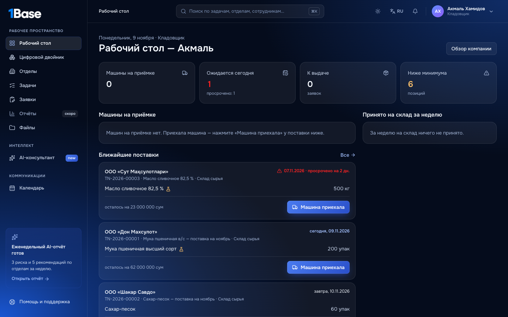

**Ближайшие поставки** — это тендеры, по которым ещё не всё привезли. Они разложены по сроку: просрочено, сегодня, завтра, на этой
неделе, позже. Значок колбы означает, что позицию проверит лаборатория. Если машина уже на приёмке, рядом написано «на приёмке
200 упак».

## 1. Машина приехала — кладовщик

1. На главной или в «Снабжение → Поставки» у нужной поставки нажмите **«Машина приехала»**.
2. Впишите госномер, водителя и номер накладной.
3. По каждой позиции укажите, сколько пришло **по накладной**:
   - если позиция ведётся по партиям, укажите номер партии поставщика, дату изготовления и срок годности;
   - если в машине две партии, нажмите «Ещё партия».
4. Нажмите **«Отправить на проверку качества»** или, если контроль качества не нужен, **«Отметить приезд»**.

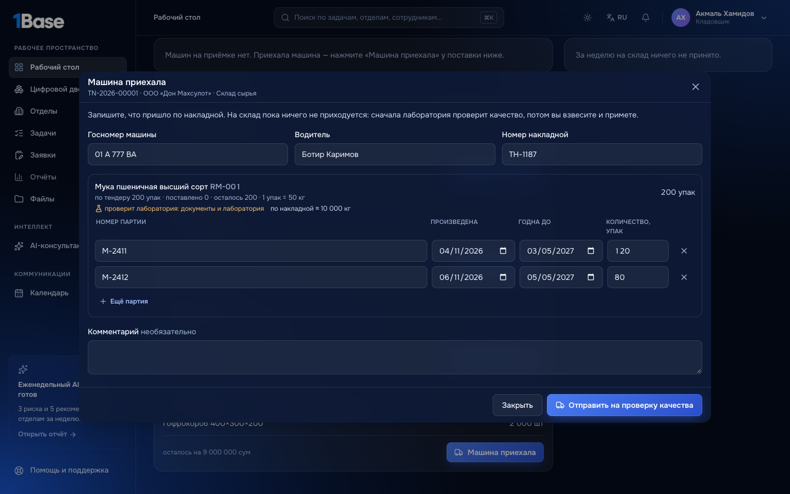

На склад пока ничего не приходуется. Позиции с контролем качества уходят лаборатории, она получает уведомление «Приехала машина —
проверьте качество». Тот, кто вёл тендер, получает «Машина приехала».

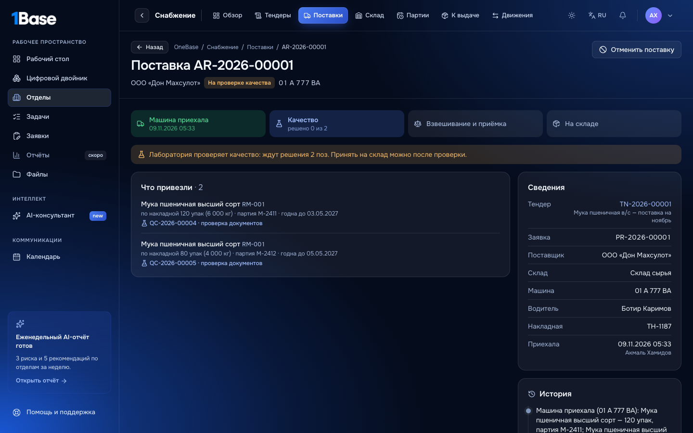

## 2. Проверка качества — лаборатория

На рабочем столе лаборатории проверки товара в машине стоят первыми, с пометкой «AR-… · в машине».

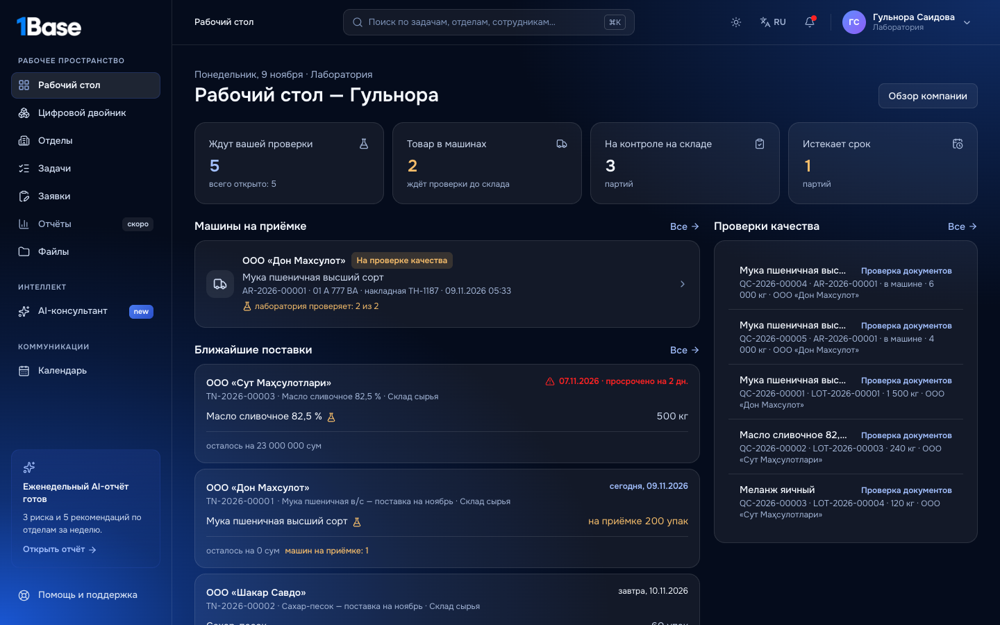

Проверка устроена так же, как раньше:
1. Документы.
2. Лаборатория: показатели по спецификации.
3. Решение назначенного по качеству — допустить или забраковать.

Отличие одно: товара на складе ещё нет. Пробу берут из машины, поэтому она только записывается и со склада не списывается.

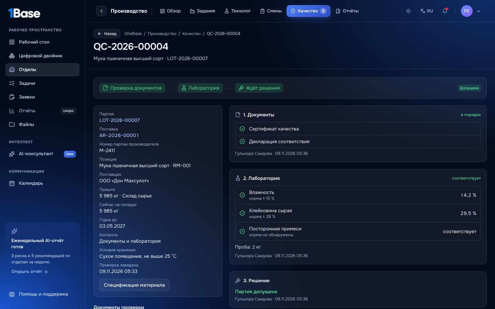

Когда решено по всем позициям:
- **есть допущенное** — поставка становится «Готово к приёмке», кладовщику приходит «Можно принимать»;
- **забракованное** — снабжению приходит «Забраковано при приёмке — вернуть поставщику». На склад оно не попадёт.
- **забраковано всё** — поставка «Возврат поставщику», кладовщику приходит «Не разгружать».

## 3. Взвешивание и приёмка — кладовщик

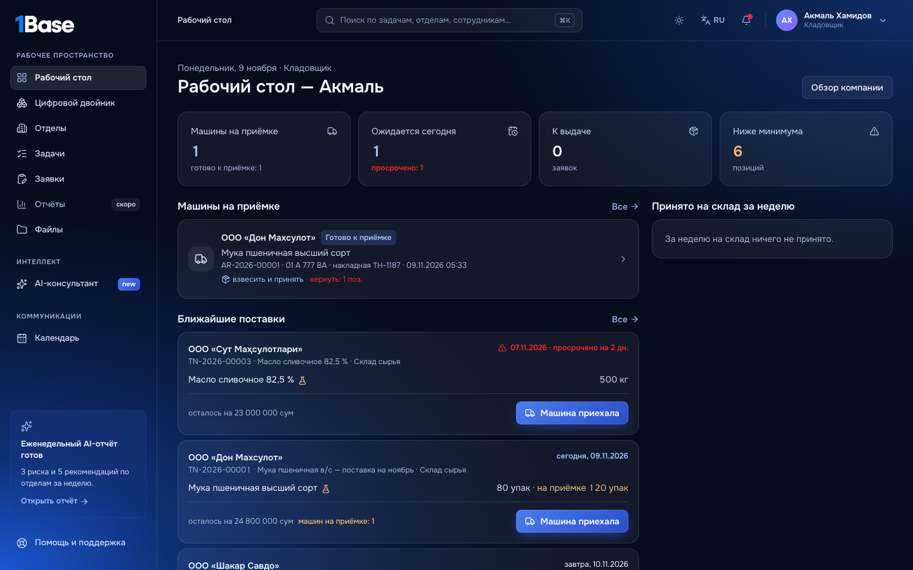

1. Откройте поставку.
2. По каждой допущенной позиции впишите, сколько **мест** принято и **вес нетто** по весам склада. Вес нужен, если позиция ведётся
   в кг, а привезли упаковками.
3. Расхождение с накладной видно сразу, например «недостача 15 кг». Если оно есть, напишите причину.
4. Нажмите **«Принять на склад»**.

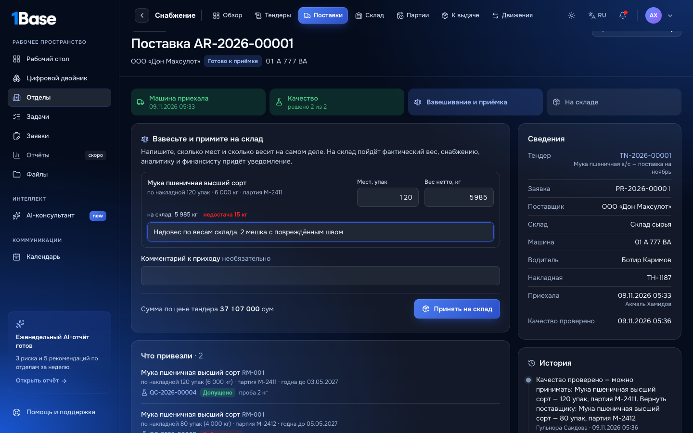

**На склад идёт фактический вес.** 120 упаковок по накладной — это 6 000 кг. Весы показали 5 985 кг — значит, на склад пришло
5 985 кг по цене тендера: 5 985 × 6 200 = 37 107 000 сум. Тендеру засчитывается 120 упаковок, оставшиеся 80 ждут следующей машины.

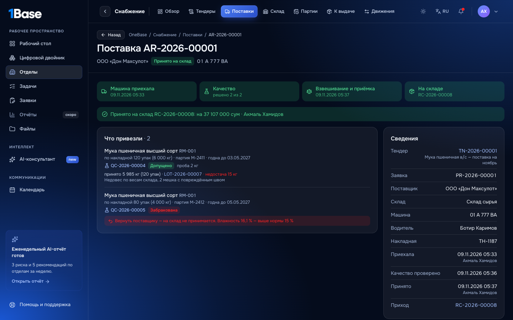

- **Одной записью проводятся:**
  - приход RC-;
  - партия, сразу допущенная и связанная со своей проверкой;
  - «поставлено» у тендера.
- **Уведомление «Принято на склад»** получают:
  - снабжение;
  - аналитики;
  - финансист;
  - автор заявки.

  В нём — что принято, на какую сумму и какие расхождения.

## 4. Что видят снабжение, аналитик, финансист, руководители

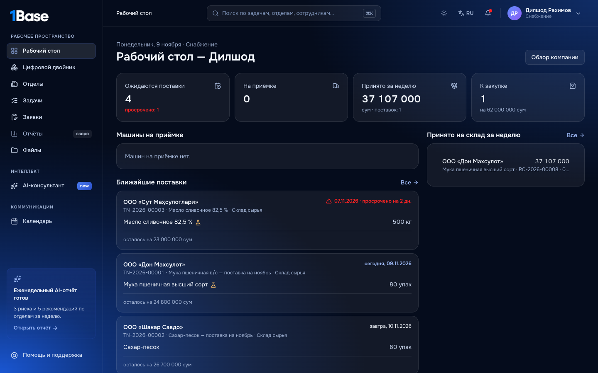

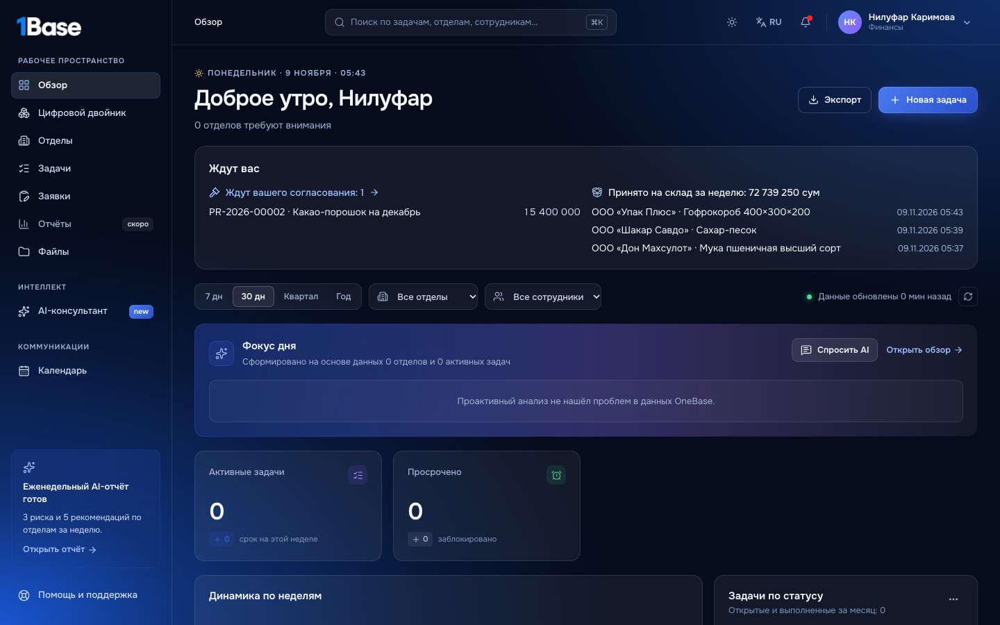

## «Куплено»: товар уже у нас или привезёт поставщик

В «Снабжение → К закупке» кнопка **«Куплено»** открывает форму с двумя вариантами:

| Вариант | Когда выбирать | Что происходит |
|---|---|---|
| **Товар уже у нас** | купили в магазине и привезли сами | купленное сразу приходуется на склад и ждёт выдачи; позиции с контролем качества встают «на контроль» на складе, как раньше |
| **Привезёт поставщик** | поставщик доставит позже | указываете, когда привезёт и на какой склад; на склад ничего не приходуется, покупка появляется у кладовщика в «Ближайших поставках» |

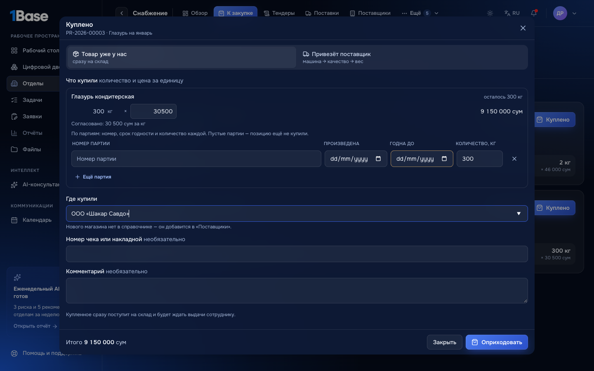

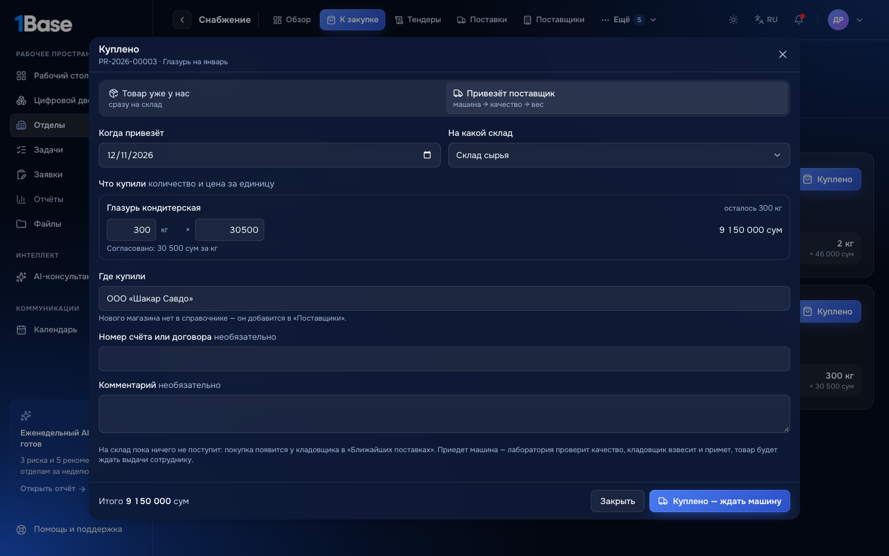

Покупка с доставкой проходит тот же путь, что и тендер:
1. Кладовщик нажимает «Машина приехала» и вписывает партии и сроки по накладной.
2. Лаборатория проверяет качество.
3. Кладовщик взвешивает и принимает.

Принятое сразу **резервируется под заявку**. Автору заявки приходит «Принято на склад по заявке — можно получить», а заявка появляется в
«К выдаче».

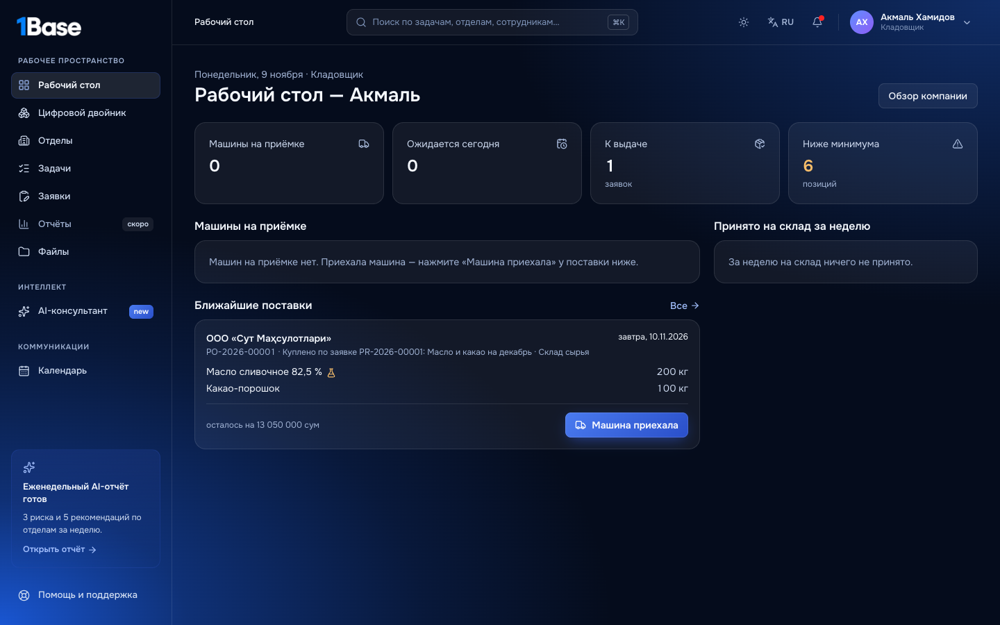

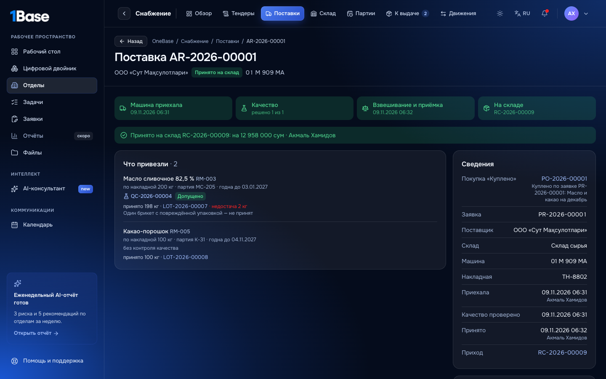

**Если поставщик довёз не всё**, недостающее остаётся в ожидаемых. В карточке покупки (PO-) есть блок «Поставка» с машинами. Снабжение
решает, что делать с остатком:
- **Поставщик довезёт** — ждём следующую машину.
- **Не довезёт** — «Закрыть остаток» с причиной, количество снова можно купить.
- **Ничего не привезёт** — «Отменить заказ», пока по покупке ничего не принято.

Пока машина на приёмке, отменить покупку или закрыть остаток нельзя.

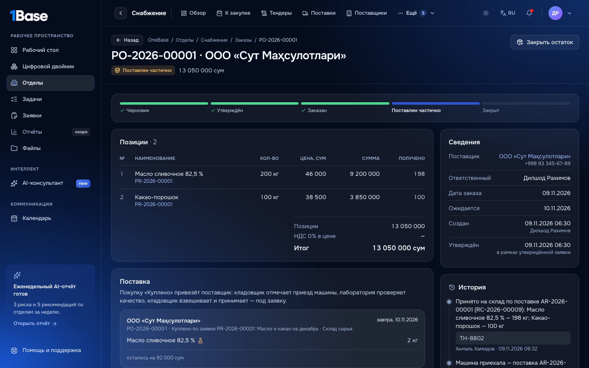

## Отмена

Машину отметили по ошибке или она уехала до приёмки: кладовщик или снабжение нажимает **«Отменить поставку»** и пишет причину.
Открытые проверки закрываются, остаток по тендеру снова можно привезти. Принятую поставку отменить нельзя.

## На телефоне

Рабочий стол и приёмка работают на телефоне, поля для мест и веса идут под названием позиции. Узбекский язык переведён полностью.

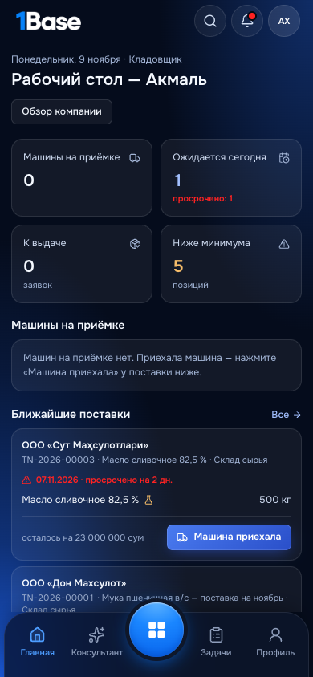 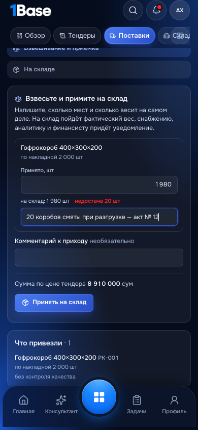 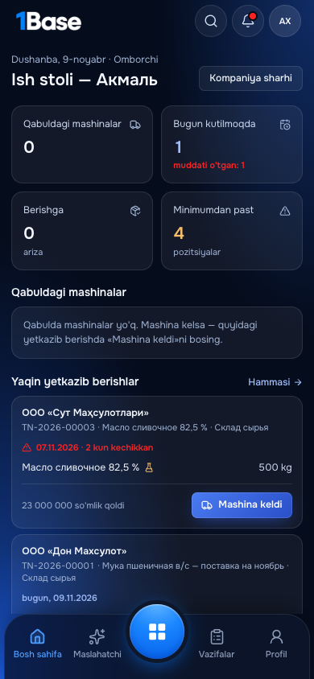

## Защита от ошибок

| Ситуация | Что сделает OneBase |
|---|---|
| Отметить больше, чем осталось по тендеру (с учётом машин на приёмке) | не даст |
| Принять до решения лаборатории | не даст |
| Принять забракованное | не даст |
| Не указать вес у весовой позиции | не даст |
| Принять 0 без причины | не даст |
| Повторное или двойное нажатие | не проведёт второй раз |
| Отметить приезд, принять или решить по качеству не по своей роли | откажет |
