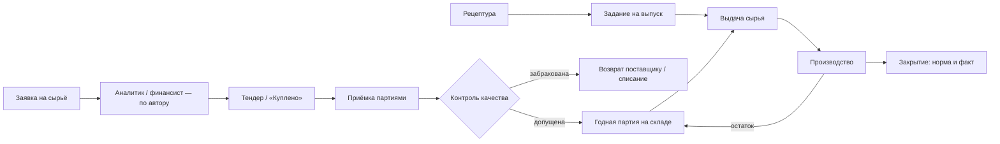
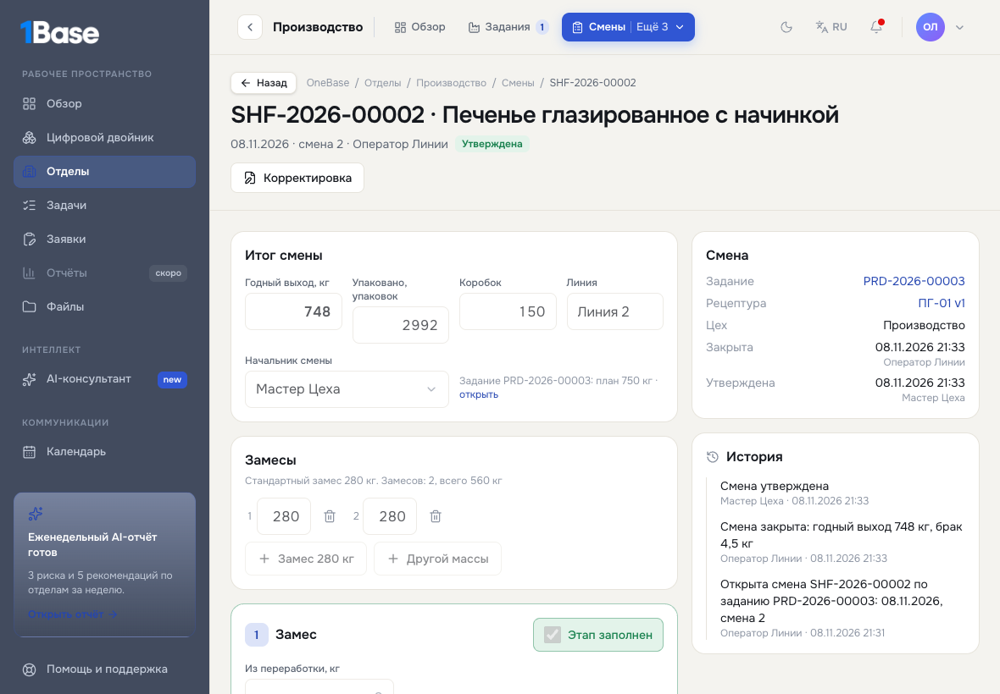
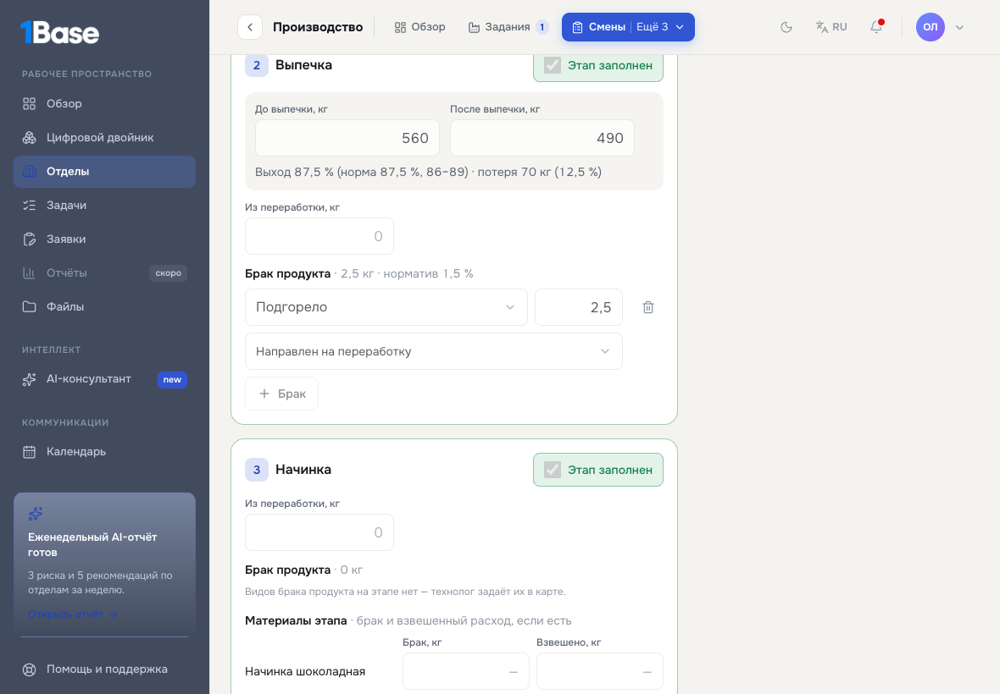
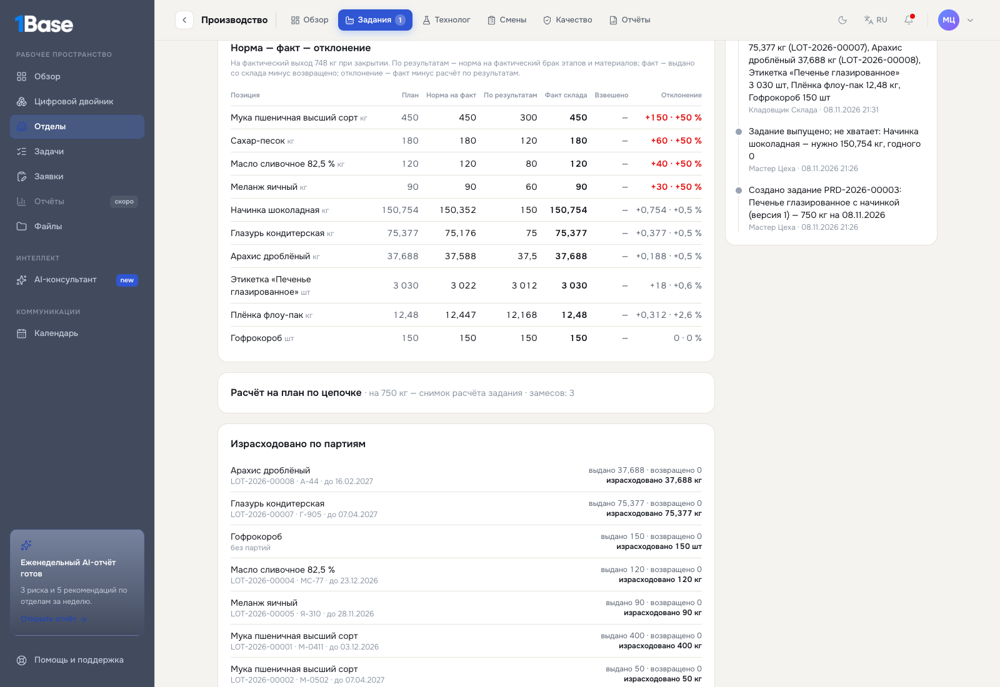
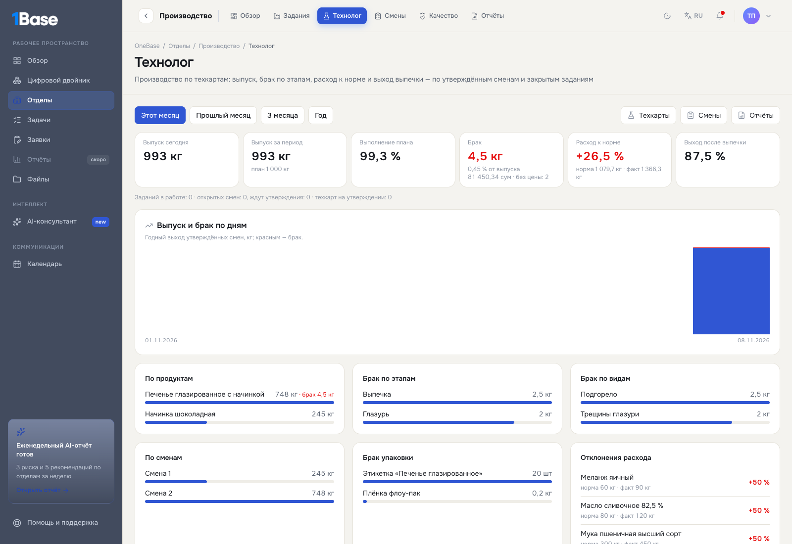

# Сырьё и производство в OneBase: как работать

Руководство для сотрудников: кто что делает, куда нажимать и что проверять. На снимках — учебные данные (вымышленные люди, позиции и
суммы). Как это устроено внутри — [docs/procurement-materials.md](../procurement-materials.md).

Версия для печати и рассылки — [raw-materials.pdf](raw-materials.pdf): снимки с пометками «куда нажать», примеры с расчётами,
сквозной пример и форматы файлов для загрузки. Техкарты, смены, сверка нормы, стоимость брака и панель «Технолог» (разделы 9–13) —
в отдельной печатной версии [technologist.pdf](technologist.pdf) (исходник — technologist.html): в raw-materials.pdf эти разделы
описывают прежние рецептуры без этапов.

Как работает вся система снабжения и производства — все функции по разделам, с примерами и расчётами — в
[supply-production.pdf](supply-production.pdf) (исходник — supply-production.html, снимки — supply-production/).
Приезд машины по тендеру теперь идёт в порядке «качество → взвешивание → склад», а у кладовщика, лаборатории, снабжения и аналитика
главная — «Рабочий стол»: [arrivals.md](arrivals.md). В PDF раздел «Тендеры» ещё описывает прежний приход партиями на контроль.

## Коротко: порядок работы

1. **Настройка (один раз)** — администратор и директор: роли сотрудников, маршрут закупки сырья, склады, кто решает по качеству.
2. **Каталог сырья** — кладовщик или снабжение: позиции, единицы закупки, партии и сроки, контроль качества.
3. **Заявка на сырьё** — снабженец, аналитик или финансист: отдельная заявка типа «Закупка сырья», что и сколько нужно.
4. **Согласование** — по автору заявки: заявку снабженца — аналитик, затем финансист; аналитика — финансист; финансиста — аналитик.
   Маршрут меняется в настройках, туда можно добавить директора.
5. **Закупка** — снабжение: тендер или «Куплено».
6. **Приёмка на склад партиями** — кладовщик: номер партии, срок годности. Сырьё с контролем встаёт «на контроль».
7. **Контроль качества** — лаборатория вносит документы и показатели, назначенный сотрудник допускает или бракует партию.
8. **Технологическая карта** — технолог: этапы изготовления, рецептура замеса, нормы, брак и упаковка, по версиям с утверждением.
9. **Задание на выпуск** — мастер: по рецептуре, план и склад.
10. **Выдача и возврат сырья** — кладовщик: только годные партии, остаток — назад в ту же партию.
11. **Закрытие задания** — мастер: фактический выход, сверка расхода с нормой.
12. **Обзор и отчёты** — директор, снабжение, производство.

## Кто участвует

| Кто | Что делает | Где в OneBase |
|---|---|---|
| **Администратор** | Роли пользователей, склады, маршрут сырья, подключение Google-таблиц | «Настройки → Пользователи», «Настройки → Отделы → Снабжение», «Настройки → Источники данных» |
| **Директор** | Утверждает закупку сырья, если его добавили в маршрут; смотрит обзор и отчёты | «Заявки → Согласования», «Производство → Обзор / Отчёты» |
| **Аналитик** (роль «Аналитик») | Создаёт заявки на сырьё; согласует заявки снабженцев и финансиста | «Заявки → Новая заявка», «Заявки → Согласования» |
| **Финансист** (выбран в настройках снабжения) | Создаёт заявки на сырьё; согласует заявки снабженцев и аналитиков | «Заявки → Новая заявка», «Заявки → Согласования» |
| **Снабжение** | Заявки на сырьё, тендер, «Куплено», поставщики, цены, отчёты | «Заявки → Новая заявка», «Снабжение → К закупке / Тендеры / Поставщики» |
| **Кладовщик** | Каталог, приход партиями, приём поставки по тендеру, выдача и возврат по заданиям, перемещения, загрузка журнала | «Снабжение → Склад / Партии / Тендеры / Движения», «Производство → Задания» |
| **Лаборатория** | Проверка документов и показателей партии, пробы, спецификации материалов | «Производство → Качество» |
| **Назначенный по качеству** | Решает: допустить, забраковать, заблокировать партию | «Производство → Качество» |
| **Технолог** (роль «Технолог») | Технологические карты: этапы, замес, нормы, брак, упаковка; утверждает чужие версии | «Производство → Технолог» |
| **Мастер / производство** (роль «Производство») | Задания на выпуск: создать, выпустить, закрыть; утверждает смены | «Производство → Задания», «Производство → Смены» |
| **Оператор** (роль «Оператор производства») | Сменный отчёт: замесы, выпечка, брак по этапам, упаковка; закрывает смену | «Производство → Смены» |
| **Любой сотрудник** | Обычные заявки; сырьё заказывает через снабжение | «Заявки → Новая заявка» |

Решения по закупке и качеству принимают **назначенные люди**, а не любой с правом: администратор со всеми правами партии не допускает и
заявки не согласует.

---

## 1. Настройка (один раз)

**Кто:** администратор (роли, склады) и директор (маршрут, правила).

1. **Роли.** «Настройки → Пользователи»: технологу — роль «Технолог», лаборанту — «Лаборатория», кладовщику — «Кладовщик», мастерам —
   «Производство», снабженцам — «Снабжение», аналитикам — «Аналитик».
2. **Маршрут закупки сырья.** «Настройки → Отделы → Снабжение → Маршрут закупки сырья»: для каждого автора заявки — шаги согласования по
   порядку.
   - Шаги на выбор: аналитик, финансист, директор, «директор, если сумма больше лимита».
   - По умолчанию:
     - заявку снабженца согласуют аналитик, затем финансист;
     - заявку аналитика — финансист;
     - заявку финансиста — аналитик.
   - Свой шаг автору не ставится: заявку аналитика не согласует аналитик.
   - Финансиста, директора и лимит выбирают там же, в «Маршруте обычных закупок».
   - Новый маршрут действует для заявок, отправленных после сохранения.

3. **Порог перерасхода** (там же, «Правила снабжения»): насколько, в процентах, расход сырья может превысить норму, прежде чем строка
   задания помечается перерасходом. По умолчанию — 5 %.
4. **Склады** (там же, ниже): центральный склад есть всегда; добавьте склад сырья и кладовые цехов, закрепите кладовщиков. Поле «Кто ведёт
   данные склада» нужно на переходный период — см. раздел [«Переходный период»](#переходный-период-журнал-склада-в-google-таблице).

   

5. **Кто решает по качеству** (там же, «Контроль качества»): отметьте сотрудников лаборатории, которые допускают и бракуют партии.

   

6. **Категории сырья.** «Заявки → Настройки»: у категорий сырья стоит флажок «сырьё». Позиции этих категорий бывают только в заявках
   «Закупка сырья», в обычных заявках их нет.

## 2. Каталог сырья

**Кто:** кладовщик или снабжение. **Где:** «Снабжение → Склад».

- **Новая позиция** — артикул, название, единица, категория, минимум. Для сырья со сроком годности включите **«Вести по партиям»** и
  укажите срок хранения. **Контроль качества**: нет, проверка документов, документы и лаборатория.
- **Единицы закупки** — если товар приходит, например, в упаковках по 50 кг, добавьте «1 упак = 50 кг»: приход и тендер можно вести в
  упаковках, на склад встанет в килограммах.
- **Загрузить каталог** — сразу много позиций из Excel. Позиции ищутся по артикулу: новые добавятся, найденные обновятся. Сначала
  OneBase показывает проверку без сохранения.

В карточке позиции видны остатки по складам, партии со сроками, единицы закупки и цены за год. Кнопка **«Что проверяют / Спецификация»**
открывает спецификацию: какие документы нужны и какие показатели проверяет лаборатория.

## 3. Заявка на сырьё

**Кто:** снабженец, аналитик или финансист. **Где:** «Заявки → Новая заявка», тип **«Закупка сырья»**.

1. Выберите тип «Закупка сырья». Под переключателем видно, кто будет согласовывать вашу заявку.
2. Укажите позиции: лучше выбрать их со склада. В заявке на сырьё предлагаются только категории и товары сырья.
3. Укажите количество и примерную цену.
4. Нажмите «Отправить».

Остальные сотрудники (технолог, мастер) заявку на сырьё не создают — им нужно обратиться в снабжение. Обычную заявку со сырьём не
отправить: система подскажет оформить отдельную заявку «Закупка сырья».

## 4. Согласование

**Кто:** по автору заявки — аналитик и (или) финансист, директор — если он есть в маршруте. **Где:** «Заявки → Согласования» (счётчик на
вкладке).

| Кто создал | Кто согласует (по умолчанию) |
|---|---|
| Снабженец | аналитик → финансист |
| Аналитик | финансист |
| Финансист | аналитик |

Откройте заявку и нажмите **«Согласовать»**, **«Вернуть на доработку»** (с комментарием) или **«Отклонить»**. После последнего шага
заявка утверждена и уходит в снабжение («К закупке»).

Свою заявку никто не согласует. Если у финансиста есть и роль «Аналитик», шаг аналитика по его заявке решает другой аналитик.

В карточке заявки виден маршрут (кто и когда согласовал) и тендеры, которые её исполняют.

## 5. Закупка: тендер или «Куплено»

**Кто:** снабжение.

- **Тендер.** «Снабжение → Тендеры → Новый тендер»: победитель, договор, срок поставки, позиции. Выберите **«Исполняет заявку»** и
  свяжите позиции с карточками склада, чтобы кладовщик смог принять поставку партиями.
- **«Куплено»** — покупка без тендера. Для сырья по партиям укажите номер партии и срок годности. Сырьё с контролем качества встанет на
  контроль; резерв под заявку появится после допуска.

## 6. Приёмка на склад партиями

**Кто:** кладовщик.

- **По тендеру:** карточка тендера → **«Принять на склад»**. Укажите, сколько пришло, по партиям: номер партии производителя, дата
  производства, срок годности. Если срок не указан, он считается от даты производства по сроку хранения. Количество — в единице тендера
  (например, в упаковках), на склад встанет в килограммах.

  

- **Без заказа:** «Снабжение → Склад → Приход» или «Приход» в карточке позиции. Для позиции с единицами закупки выберите единицу.

  

Сырьё с контролем качества встаёт **«на контроль»**: его не выдать и не зарезервировать, пока партию не допустят.

## 7. Контроль качества

**Кто:** лаборатория и назначенный по качеству. **Где:** «Производство → Качество».

Проверка идёт по шагам:

1. **Документы** — отметьте документы из спецификации: сертификат, декларация и другие.
2. **Лаборатория** (если она нужна) — значения показателей; OneBase сам сравнит их с нормой. Проба списывается с партии.
3. **Решение** — назначенный нажимает **«Допустить»** или **«Забраковать»** (с комментарием). Забракованную партию возвращают
   поставщику или списывают.

## 8. Партии и сроки

**Где:** «Снабжение → Партии». Остаток каждой партии, срок годности (цвет: истекает, просрочено), статус качества. Выдаются только
допущенные партии в сроке, по умолчанию сначала с ближайшим сроком (FEFO).

## 9. Технологическая карта

**Кто:** технолог. **Где:** «Производство → Технолог».

1. **«Новая техкарта»** — карточка продукта:
   - код и название;
   - товар Linko;
   - номер карты, ответственный технолог, дата начала действия;
   - на какое количество заданы нормы — например, на 1 000 кг.
2. **Технологическая цепочка.** Нажмите **«Типовая цепочка»** (замес → выпечка → начинка → глазурь → охлаждение → упаковка) или
   добавляйте этапы по одному. Этапы можно переставлять (стрелки), копировать, удалять и переименовывать.
3. **Для каждого этапа:**
   - тип операции, участок;
   - **выход, %** — сколько выходит от всего, что поступило на этап (выпечка 280 → 245 кг — 87,5 %), с допуском мин.–макс.;
   - влажность — для выпечки и охлаждения.
4. **Компоненты этапа** — позиции склада с нормой:
   - у **замеса** — рецептура одного замеса; масса замеса считается сама, задайте мин. и макс. массу и можно ли частичный замес;
   - у **упаковки** — на упаковку, коробку или штуку; укажите массу нетто упаковки и сколько упаковок в коробке;
   - у остальных этапов — на выход рецептуры (например, 200 кг начинки на 1 000 кг).
   - Норму можно задать в граммах или в единице закупки («мешок»), потери — в %.
5. **Виды брака этапа** — название и норматив, %. Брак продукта учитывает материалы этого и прежних этапов: брак до глазури не тратит
   глазурь. Брак материала (например, этикеток) увеличивает только расход этого материала.
6. Сохраняется **черновик**. Если карта не считается (не хватает массы упаковки, компоненты тяжелее выхода…), вверху видно, что исправить.
7. **«На утверждение»** — версию утверждает **другой технолог или начальник производства** (руководитель отдела «Производство»): кнопки
   **«Утвердить»** или **«Вернуть»** с причиной. Свою версию утвердить нельзя. Утверждённая версия — действующая: по ней создают задания.
8. **Изменить утверждённую нельзя** — нажмите **«Новая версия»**: создастся черновик-копия с этапами, компонентами и браком. После
   утверждения прежняя версия уйдёт в архив; задания, созданные по ней, сохраняют свои расчёты. **«Сравнить»** в списке версий
   показывает, что изменилось.
9. **Схема цепочки** в карточке показывает, что поступает на каждый этап, выход, потери, брак и что уходит дальше — на 1 000 кг.
   **«Расчёт на выпуск»** — сколько замесов, сырья, начинки, глазури и упаковки нужно на любое количество и хватает ли годного на складе.

## 10. Задание на выпуск

**Кто:** мастер или руководитель производства. **Где:** «Производство → Задания → Новое задание».

1. Выберите рецептуру, сколько выпустить, дату, цех и склад, с которого берётся сырьё. Ниже сразу видна потребность и чего не хватает.

   

2. **«Сохранить черновик»**, затем в карточке нажмите **«Выпустить»**: потребность зафиксируется. Если годного сырья не хватает, мастер и
   снабжение получат уведомление.

   

## 11. Выдача и возврат сырья

**Кто:** кладовщик склада задания. **Где:** карточка задания.

- **«Выдать сырьё»** — по каждой позиции сколько выдать. Партию можно не выбирать: OneBase возьмёт годные партии с ближайшим сроком. Если
  выдаёте больше потребности, укажите причину — отклонение будет видно при закрытии.

  

- **«Возврат на склад»** — остаток после смены. Он возвращается в ту же партию и не больше того, что у цеха на руках.

  

В карточке видно, что выдано, что вернули и какие партии у цеха.

## 11а. Смена: ввод оператора

**Кто:** оператор (роль «Оператор производства») или мастер. **Где:** «Производство → Смены → Новая смена» или в задании —
«Смены и новая смена».

1. Выберите выпущенное задание, дату, номер смены, линию; оператор — по умолчанию вы.
2. В сменном отчёте:
   - **итог смены** — годный выход, сколько упаковок и коробок;
   - **замесы** — кнопка «Замес 280 кг» добавляет стандартный, «Другой массы» — свой;
   - **для каждого этапа:**
     - выпечка — масса до и после: выход, потеря и отклонение от нормы видны сразу; если выход вне допуска, укажите причину;
     - влажность;
     - **брак по видам** в кг: можно «направить на переработку», если технолог это разрешил;
     - «Из переработки, кг» — сколько брака вернули в производство на этот этап;
     - брак материалов (этикетки, плёнка) и взвешенный расход;
     - отметьте **«Этап заполнен»**.
3. Ввод **сохраняется сам** через секунду после правки. Если обновить страницу или пропадёт связь, ничего не потеряется — ввод хранится и
   в браузере.
4. Справа видно, чего не хватает. Когда всё заполнено, нажмите **«Закрыть смену»**.
5. **Утверждает** мастер или начальник производства — не тот, кто закрыл. Он может вернуть смену на ввод с причиной.
6. **Утверждённая смена не правится.** Ошибку исправляет **«Корректировка»** — копия смены, где нужно указать причину. После
   утверждения корректировка заменяет смену в расчётах.
7. Внизу смены — **расчёт по результатам**: сколько сырья, начинки, глазури и упаковки положено на то, что сделала смена, с её
   фактическим браком.
8. У техкарты **без этапов** в смене — годный выход и блок «Сырьё»: сколько взвесили по каждой позиции, если взвешивали.

## 12. Закрытие задания и сверка нормы

**Кто:** мастер. **Где:** карточка задания → **«Закрыть задание»**.

Введите фактический выход — по умолчанию подставлен годный выход утверждённых смен. OneBase посчитает норму на фактический выход по
цепочке техкарты (замесы, брак этапов, упаковка) и сравнит с расходом (выдано минус возвращено).

**С чем сравнивается расход.** Если по заданию есть утверждённые смены — с расходом **по их результатам**: на фактические замесы и
фактический брак. Без смен — с нормой на фактический выход. Так видно сырьё, которое выдали, но не использовали: норма с нормативным
браком требовала 3 замеса, смена сделала 2 — мука третьего замеса будет перерасходом, пока её не вернут на склад. Поэтому **остаток у
цеха возвращайте до закрытия**. Перерасход больше порога из настроек помечается красным, руководитель производства получает уведомление.

**«Норма — факт — отклонение»** в карточке задания по каждой позиции показывает:
- план;
- норму на факт;
- расчёт по результатам смен;
- факт склада;
- взвешенное в сменах;
- отклонение.

**Выход на склад.** Если в техкарте указана **позиция склада выхода** (полуфабрикат: начинка, глазурь), после закрытия кладовщик склада
нажимает **«Оприходовать выход»**. Создаётся партия со сроком по сроку хранения позиции. Дальше её выдают в другие задания, как сырьё;
по одной партии видно, в какие продукты она ушла. Второй раз выход по заданию не приходуется. Готовую продукцию приходуют так, только
если её учитывают на складе OneBase — иначе ею владеет Linko.

**Цена партии выхода** — сырьё задания по цене выданных партий на единицу выхода (без труда и накладных): начинка из сахара 150 кг по
9 000 и какао 100 кг по 38 000 при выходе 245 кг — 21 020,41 сум за кг. Если часть сырья выдана без цены партии (позиция ведётся без
партий или у партии нет цены), у партии выхода цены нет.

## 13. Обзор и отчёты

**Кто:** директор, снабжение, производство, технолог, оператор, кладовщик, лаборатория.

- **«Производство → Технолог»** — панель за период:
  - выпуск сегодня и за период, план и его выполнение;
  - брак — кг, % и **стоимость по цене партий**, выданных в задания; если у части материалов нет цены партии, видно, у скольких
    (их названия — во всплывающей подсказке);
  - расход к норме, выход после выпечки;
  - график выпуска и брака по дням;
  - по продуктам и сменам; брак по этапам и видам; брак упаковки; отклонения расхода;
  - задания в работе — с нехваткой сырья;
  - что требует внимания: нехватка, перерасход, брак выше норматива, техкарты на утверждении.

  

- **Новые отчёты** («Производство → Отчёты», Excel и PDF): «Производство», «Брак», «Расход: норма и факт», «Упаковка»,
  «Полуфабрикаты», «Рецептуры».
- **Стоимость брака** в отчёте «Брак» — по цене партий, выданных в задание смены:
  - брак продукта — всё, что в него вложено до этого этапа и на нём, по норме с потерями: 2,5 кг подгоревшего печенья — это 2,857 кг
    теста (мука, сахар, масло, меланж), без начинки и глазури; 2 кг брака глазури — тесто, начинка, глазурь и орехи;
  - брак материала (этикетки, плёнка) — количество × цена партии;
  - если у материала нет цены партии, он назван в колонке «Без цены партии», другая цена не подставляется.

- **«Производство → Обзор»** — запас сырья в деньгах, партии на контроле, истекающие сроки, ниже минимума, задания в работе, расход и
  норма за период, дни запаса, закупки сырья на согласовании и рост цен.

  

- **«Производство → Отчёты»** — «Партии и сроки», «Контроль качества», «Расход и норма», «Движения по партиям», «Сверка позиций и партий».
  Каждый отчёт можно выгрузить в Excel и PDF.

  

## Переходный период: журнал склада в Google-таблице

Пока склад ведётся в таблице, OneBase загружает её журнал. Чтобы одну и ту же выдачу не провели дважды — из таблицы и вручную, — у
склада один владелец данных («Настройки → Отделы → Снабжение → Склады → Кто ведёт данные склада»):

- **«Таблица»** — остатки приходят только загрузкой журнала; ручные операции по складу закрыты, кроме контроля качества.
- **«OneBase»** — загрузка журнала закрыта, всё ведётся в OneBase.
- **«Не выбран»** — можно и так и так (как было раньше).

**Как подключить таблицу:**

1. Администратор добавляет таблицу в «Настройки → Источники данных» и даёт к ней доступ.
2. Кладовщик: «Снабжение → Движения → **Google-таблица** → Добавить лист»: склад, таблица, лист, расписание (кнопкой, каждые N минут, раз в
   день).
3. **«Проверить»** показывает, что загрузится, без сохранения; **«Загрузить сейчас»** загружает. Повторная загрузка не проводит строки второй
   раз.

Лист устроен так же, как файл журнала для «Импорта из Excel»: дата, приход или расход, артикул или название, количество, цех; для сырья —
номер партии и срок годности.

## Частые вопросы

- **Почему партию не выдать?** Она на контроле качества, забракована, заблокирована или просрочена. Причина видна в «Партиях» и в карточке
  позиции.
- **Почему нельзя сторнировать приход?** Не сторнируются поставка по тендеру, выдача и возврат по заданию, пробы лаборатории и возврат
  поставщику: они уже учтены в тендере, задании или проверке. Исправление делается новым документом, например возвратом из производства.
- **Почему не отменить задание?** У цеха на руках сырьё по заданию — сначала оформите возврат.
- **Почему заявка ждёт?** Её шаг некому решить:
  - нет пользователей с ролью «Аналитик», кроме автора;
  - не выбран финансист или директор.

  Тем, кто настраивает снабжение, приходит уведомление. В карточке заявки у такого шага — подсказка, где это исправить.
- **Почему не добавить сырьё в обычную заявку?** Сырьё закупается только отдельной заявкой «Закупка сырья», её создают снабженцы, аналитики
  и финансист.
- **Где история?** У заявки, тендера, рецептуры, задания и партии внизу карточки — кто, что и когда сделал.
