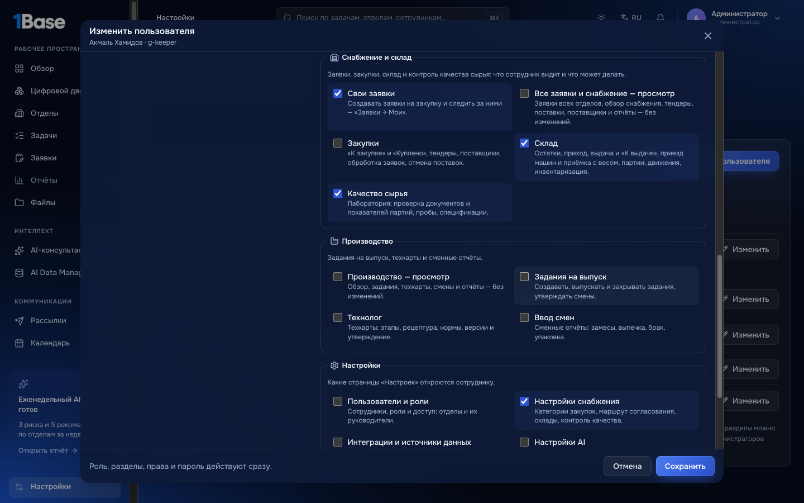
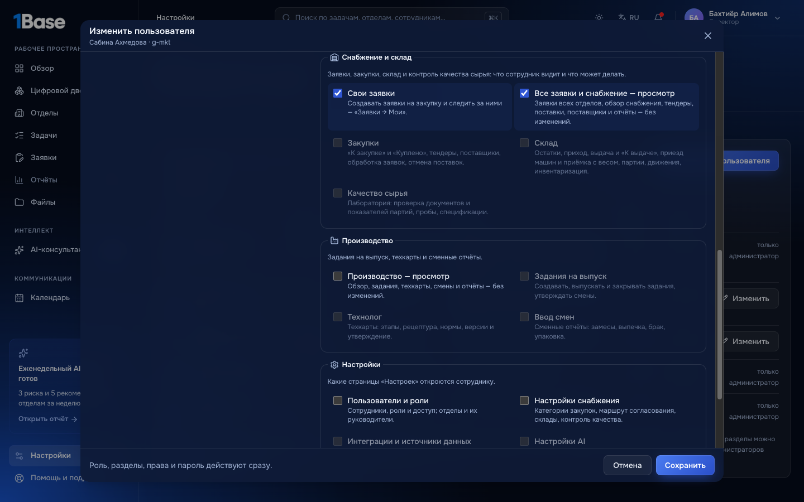
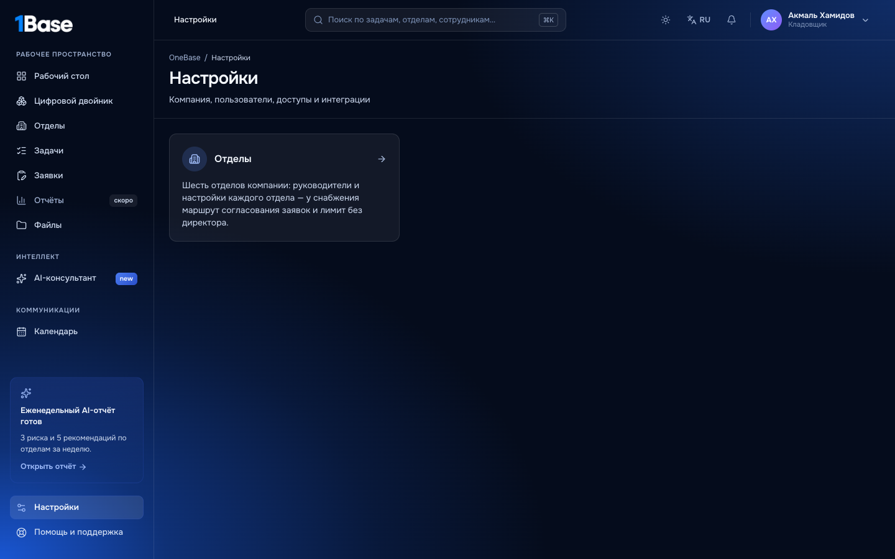
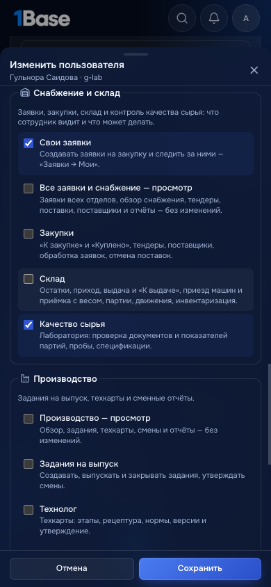

# Доступ сотрудника: разделы, действия в отделах и настройки — инструкция

«Настройки → Пользователи и роли» → «Добавить пользователя» или «Изменить». Справа, в блоке **«Доступ»**, три уровня.

1. **Роль** — с чего начать. Она подставляет галочки ниже.
2. **Разделы** — какие разделы открыты: продажи, финансы, HR, задачи, файлы, AI-консультант и другие.
3. **Действия в отделах и настройки** — что сотрудник может делать внутри отделов и какие страницы «Настроек» ему открыты. Сгруппированы
   так:

| Группа | Галочки |
|---|---|
| Снабжение и склад | свои заявки; все заявки и снабжение — просмотр; закупки («к закупке», «Куплено», тендеры, поставщики); склад (приход, выдача, приезд машин, приёмка с весом); качество сырья (лаборатория) |
| Производство | просмотр; задания на выпуск; технолог (техкарты); ввод смен |
| Настройки | пользователи и роли; настройки снабжения; интеграции и источники данных; AI; Telegram; продажи: оргструктура и цели; журнал ошибок |

## Как это работает

- **Галочки как у роли.** Значок «как у роли»: сотрудник идёт за ролью, изменится роль — изменятся и его права.
- **Изменили галочку** — значок «настроены вручную» и кнопка «Как у роли», чтобы вернуть всё назад. В списке пользователей у такого
  сотрудника метка «вручную».
- **Действие включает просмотр.** «Закупки» включают «Все заявки — просмотр», а «Задания», «Технолог» и «Ввод смен» — «Производство —
  просмотр». Если снять просмотр, снимутся и действия, которым он нужен.
- **«Продажи: оргструктура и цели»** работают только вместе с разделом «Продажи». Если снять раздел, снимется и это право.
- **Выдать можно только то, что есть у вас самих.** Остальное серое, с подсказкой «выдать может администратор». Директор не выдаст
  «Склад», «Качество сырья» или «Интеграции»: у роли директора их нет.

  

- **Свои права изменить нельзя** — попросите другого администратора.
- **Права действуют сразу**, повторно входить не нужно. По ним открываются:
  - пункты меню и вкладки разделов;
  - кнопки действий: «Машина приехала», «Принять на склад», «Допустить», «Куплено», «Выпустить» и другие;
  - страницы «Настроек».

  

- **Уведомления «по праву»** приходят по тем же галочкам. Отметили сотруднику «Качество сырья» — ему придёт «Приехала машина — проверьте
  качество». Сняли «Склад» — перестанут приходить «Можно принимать».

## На телефоне

Окно открывается снизу, галочки идут одной колонкой.

